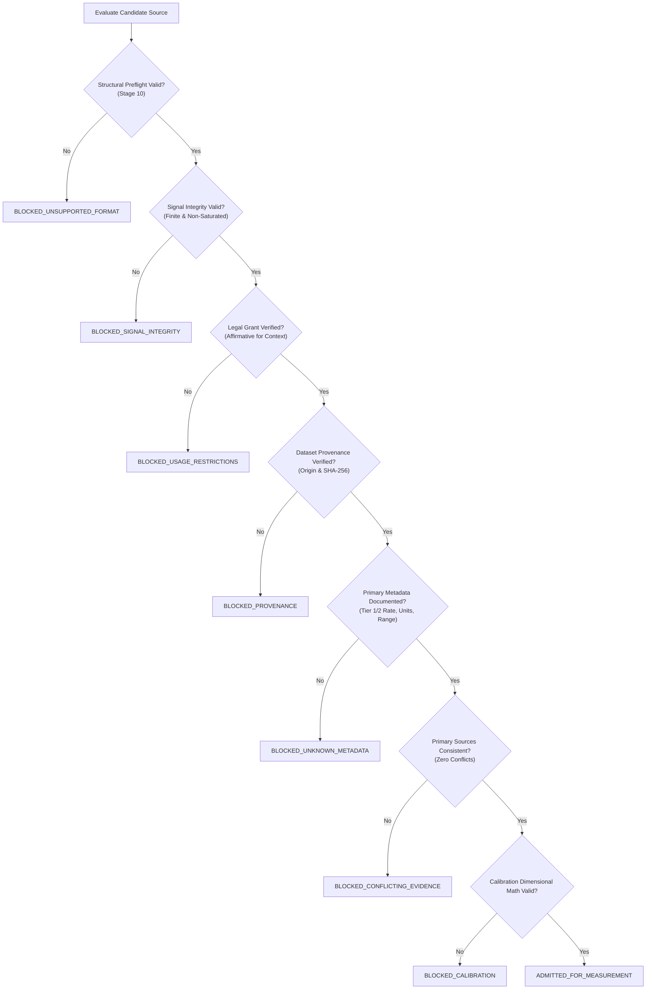

# 11-calibration-measurement-protocol: Calibration, Measurement Evidence & Real-Data Admission Protocol Design (Repaired)

**Document ID:** `docs/edge-sentinel/11-calibration-measurement-protocol.md`  
**Stage:** 11 — Calibration, Measurement Evidence & Real-Data Admission Protocol (Repair 01)  
**Author:** Edge Sentinel Research, Systems & Data Engineering  
**Workspace:** `/Users/manuvashistha/Developer/ADI`  
**Supervisor:** Manu Vashisth  
**Prerequisite:** Stage 10 Accepted as Final Acceptance Closeout (`handoff/edge-sentinel/10-final-acceptance-closeout.md`)  
**Supervisor Review Reference:** Stage 11 Review (`reviews/edge-sentinel/11-calibration-measurement-protocol.md`)  
**Scope:** Protocol Design and Verification Specification Only (Zero Remote Downloads, Zero Schema Modifications, Zero Real-Data Ingestion, Zero Threshold Fitting)  
**Status:** REPAIRED DESIGN SPECIFICATION — READY FOR SUPERVISOR REVIEW  

---

## 1. Executive Summary, Scope & Inviolable Boundaries

### 1.1 Objective & Context
Following the formal acceptance of Stage 10 (`handoff/edge-sentinel/10-final-acceptance-closeout.md`), the Analog Devices Edge Sentinel architecture possesses a fully verified, bounded local source-inspection subsystem. The Stage 10 inspector deterministically verifies uncompressed MATLAB Level 5 container structures, computes cryptographic SHA-256 byte digests, enforces snapshot memory boundaries (50 MB), restricts worker IPC (2 MB / 1 MB), validates matrix sub-elements and variable name tags before SciPy invocation, and publishes schema-conforming exploratory inspection records (`ExploratorySourceInspectionV1`).

However, as established in the Stage 07 audit (`docs/edge-sentinel/07-real-data-audit.md`) and Stage 08 design (`docs/edge-sentinel/08-exploratory-inspection-design.md`), **structural container validity does not establish scientific measurement validity**. A file that parses cleanly into an IEEE 754 double-precision array of shape $[1, N]$ provides no inherent proof of:
1. Physical transducer calibration, sensitivity ($S_a$), or calibrated measurement engineering units ($g$, $\text{m/s}^2$).
2. True temporal sampling rate ($f_s$), sampling clock stability, or anti-aliasing filter characteristics.
3. Electrical analog front-end (AFE) dynamic range, analog-to-digital converter (ADC) scale factors, encoding formats, or sensor saturation clipping limits.
4. Physical specimen identity, test rig kinematic dependencies, or operational regime.
5. Legal usage rights, copyright licensing, or redistribution grants across specific deployment contexts.

This document establishes the repaired formal **Measurement Evidence, Calibration, Provenance, and Real-Data Admission Protocol (Stage 11 Repair 01)**. It addresses all critical, high, and medium review findings identified in independent supervisor review:
- Eliminates semantic loopholes in the evidence schema by enforcing strict Draft 2020-12 `oneOf` status-dependent invariants.
- Completely removes invented nominal uncertainty assignments ($\pm 2.0\%$), replacing them with rigorous fail-closed GUM absolute standard uncertainty propagation.
- Reconciles the complete ADC-to-acceleration calibration mathematics across signed bipolar, unsigned unipolar, and offset binary encodings, preventing double application of AFE gain.
- Harmonizes the decoupling between single-recording **Physical Measurement Admission** and multi-recording **Supervised Diagnostic Evaluation Eligibility**.
- Formalizes the clipping policy threshold ($0.01\%$) as a provisional engineering heuristic with sample-count rounding and consecutive flat-top checks.
- Disaggregates legal permissions across five distinct operational contexts (academic, commercial R&D, internal testing, redistribution, artifact release).
- Resolves all missing field references and provides an exhaustive Stage 07 blocker-to-evidence traceability matrix.

### 1.2 Inviolable Architectural Boundaries
In strict compliance with project guidelines and supervisor directives:
- **Protocol Design Only:** This stage delivers formal specifications, proposed data contracts, mathematical calibration formulas, and verification audit procedures. No runtime code is modified, no external datasets are downloaded or ingested, and no learned neural models or threshold detectors are fitted.
- **Contract Non-Contamination:** Existing production contracts (`VibrationRecordingV1`, `AnomalyDecisionV1`, and `ExploratorySourceInspectionV1`) and their canonical validators in `adi-common` are **preserved untouched**. Proposed Stage 11 contracts (`CalibrationMeasurementEvidenceV1`, `MeasurementAdmissionDecisionV1`) are design specifications and must not be retroactively injected into existing production schemas.
- **Strict Decoupling of Inspection and Admission:** A clean structural inspection result (`STRUCTURAL_SUCCESS` in Stage 10) is a prerequisite for evaluation, but **never grants admission** for physical measurement or detector evaluation. Measurement admission requires independent, documented evidence verified against a formal authority hierarchy.
- **Deterministic Fail-Closed Governance:** Any missing physical parameter (sensitivity, full scale, units, sampling rate), ambiguous specimen identity, or unstated legal license unconditionally forces a blocking admission decision. No default values, heuristic conversions, or nominal assumptions are permitted.
- **Data Leakage & Evaluation Protection:** Real-data diagnostic claims are strictly forbidden without demonstrated physical specimen independence and complete temporal window separation.

```
┌────────────────────────────────────────────────────────────────────────────────────────────────────────┐
│                          STAGE 11 REPAIRED EVIDENCE & ADMISSION ARCHITECTURE                           │
│                                                                                                        │
│   UNVERIFIED RAW CONTAINER             STAGE 10: LOCAL SOURCE INSPECTION                               │
│   ┌────────────────────────┐           ┌──────────────────────────────────────────────────────────┐    │
│   │ Candidate .mat file    │ ────────► │ ExploratorySourceInspectionV1                            │    │
│   │ Raw Source Bytes       │           │ - raw_byte_sha256, byte_size, container_format: MATLAB_V5 │    │
│   └────────────────────────┘           │ - numeric_shape: [1, N], dtype: float64                  │    │
│                                        │ - structural_status: STRUCTURAL_SUCCESS                  │    │
│                                        │ - measurement_readiness: BLOCKED_UNKNOWN_METADATA        │    │
│                                        │ - detector_admission_eligible: false                     │    │
│                                        └──────────────────────────────────────────────────────────┘    │
│                                                                      │                                 │
│                                                                      ▼                                 │
│   EXTERNAL EVIDENCE SOURCES            STAGE 11: EVIDENCE MODEL & CALIBRATION                          │
│   ┌────────────────────────┐           ┌──────────────────────────────────────────────────────────┐    │
│   │ - Calibration Certs    │ ────────► │ CalibrationMeasurementEvidenceV1                        │    │
│   │ - Sensor Datasheets    │           │ - Primary Transducer Sensitivity & Units (Tier 1/2)      │    │
│   │ - DAQ Hardware Logs    │           │ - Native Clock Provenance & Certified fs (Tier 1/2)      │    │
│   │ - Specimen Logs        │           │ - Sensor Dynamic Range & Full-Scale Clipping Limit       │    │
│   │ - Legal Grants         │           │ - Strict Draft 2020-12 oneOf Status Invariants           │    │
│   └────────────────────────┘           │ - Explicit Contextual Legal Grants                       │    │
│                                        └──────────────────────────────────────────────────────────┘    │
│                                                                      │                                 │
│                                                                      ▼                                 │
│                                        STAGE 11: FORMAL ADMISSION GATE                                 │
│                                        ┌──────────────────────────────────────────────────────────┐    │
│                                        │ MeasurementAdmissionDecisionV1                           │    │
│                                        │ - measurement_admission_status:                          │    │
│                                        │     ADMITTED_FOR_MEASUREMENT                             │    │
│                                        │     (or BLOCKED_UNKNOWN_METADATA, BLOCKED_CALIBRATION, ..)│   │
│                                        │ - diagnostic_evaluation_eligibility:                     │    │
│                                        │     Sub-record evaluating specimen distinctness,         │    │
│                                        │     ground truth labels, and anti-leakage grouping.      │    │
│                                        └──────────────────────────────────────────────────────────┘    │
│                                                                      │                                 │
│                         ┌────────────────────────────────────────────┴─────────────────────────────┐   │
│                         │ ADMITTED_FOR_MEASUREMENT ONLY                                            │   │
│                         ▼                                                                          │   │
│   CALIBRATED RECORDING CONTRACT        PRODUCTION ANALYSIS PIPELINE (EXISTING)                     │   │
│   ┌────────────────────────┐           ┌──────────────────────────────────────────────────────┐    │   │
│   │ VibrationRecordingV1   │ ────────► │ Threshold Reference Anomaly Detector                 │    │   │
│   │ - certified unit (g)   │           │ - evaluate_rms_threshold                             │    │   │
│   │ - certified rate (Hz)  │           │ - Window Features (stable_rms)                       │    │   │
│   │ - calibrated samples   │           │ - Full-Scale Saturation Gate (reasons: SATURATION)   │    │   │
│   │ - proven machine_id    │           │ - Emits: AnomalyDecisionV1                           │    │   │
│   └────────────────────────┘           └──────────────────────────────────────────────────────┘    │   │
└────────────────────────────────────────────────────────────────────────────────────────────────────────┘
```

---

## 2. The Exact Gap Between Structurally Valid Data and Physically Meaningful Measurements

The research audit of Stage 07 (`docs/edge-sentinel/07-real-data-audit.md`) and the exploratory design of Stage 08 (`docs/edge-sentinel/08-exploratory-inspection-design.md`) identified fundamental gaps between container structure and physical measurement physics. These gaps are formalized below into five mandatory barrier dimensions:

```
+-------------------------------------------------------------------------------------------------------+
| STRUCTURAL CONTAINER FACT (STAGE 10)           PHYSICAL MEASUREMENT GAP (STAGE 11 PREREQUISITE)       |
+-------------------------------------------------------------------------------------------------------+
| 1. Array shape [1, N] of float64               -> Stored values are dimensionless floating-point      |
|    numbers. Without documented transducer sensitivity, ADC encoding, and AFE gain, amplitude 0.5      |
|    cannot be distinguished between 0.5 V, 0.5 mV, 0.5 g, 0.5 m/s^2, or raw ADC counts.                 |
+-------------------------------------------------------------------------------------------------------+
| 2. Sample sequence index k in [0, N-1]         -> Array index provides sequence ordering only.        |
|    Without a certified hardware sampling clock, time delta dt = 1/fs is unknown. Sample count N       |
|    cannot establish sampling rate. Spectral, order-tracking, and kinematic analysis are impossible.  |
+-------------------------------------------------------------------------------------------------------+
| 3. Raw numeric extrema [min, max]              -> Observed extrema reflect signal excursion in file,  |
|    not sensor dynamic range. Without documented acquisition full scale (V_FS or A_FS), clipping and   |
|    saturation cannot be evaluated. Severe impact clipping appears as flat signal tops.                |
+-------------------------------------------------------------------------------------------------------+
| 4. Variable name "DE_time"                     -> String label hints at motor housing location, but   |
|    fails to prove transducer mounting method (stud vs magnet), axis orientation (radial vs axial),    |
|    sensor frequency response, or test rig specimen independence across load variations.               |
|    Drive End and Fan End accelerometers are distinct physical locations, NOT orthogonal axes (x,y,z).|
+-------------------------------------------------------------------------------------------------------+
| 5. Public URL / Open Web Host                  -> Open HTTP accessibility does not constitute a legal |
|    license. Without an affirmative license grant, redistribution and processing risk copyright breach.|
|    Permissions must be evaluated specifically against the intended operational activity.              |
+-------------------------------------------------------------------------------------------------------+
```

### 2.1 The Amplitude Interpretation Gap (Voltage vs. Acceleration)
In industrial condition monitoring, accelerometers generate electrical charge or voltage proportional to physical acceleration:
- Piezoelectric (IEPE/ICP) accelerometers produce an analog voltage across an internal amplifier:
  $$V(t) = S_a \cdot a(t) + V_{\text{bias}}$$
  where $S_a$ is the calibrated sensitivity (typically $100\text{ mV/g}$ or $10.2\text{ mV/(m/s}^2\text{)}$) and $V_{\text{bias}}$ is the DC excitation bias ($\sim 8\text{--}12\text{ VDC}$ decoupled by an AC-coupling high-pass filter).
- Analog-to-Digital Converters (ADCs) sample this voltage into digital quantization codes:
  $$D[k] = \text{quantize}\left( \frac{V(k \cdot \Delta t) \cdot G_{\text{amp}}}{V_{\text{ref}}} \cdot (2^{B-1} - 1) \right)$$
- When data acquisition (DAQ) software writes to disk, it may store:
  1. Raw unscaled integer ADC codes $D[k]$ (signed two's complement, unsigned, or offset binary).
  2. Scaled ADC voltage in millivolts or volts: $V[k] = D[k] \cdot \text{LSB}$.
  3. Pre-calibrated acceleration in engineering units ($g$ or $\text{m/s}^2$): $a[k] = V[k] / S_a$.
  4. Normalized, standardized, or arbitrary unitless floating-point values.

**The Structural Trap:** A MATLAB Level 5 `.mat` file stores only the array `double` bytes. The file contains **zero self-describing metadata** indicating whether the numbers represent $D[k]$, $V[k]$, $a[k]$, or an arbitrary mathematical transformation. Inferring physical units from numeric range (e.g., observing values between $-2.5$ and $+2.5$ and guessing they represent $g$) is unscientific: a $100\text{ mV/g}$ sensor measuring $\pm 25\text{ g}$ produces $\pm 2.5\text{ V}$. Confusing volts with $g$ introduces a **$10\times$ amplitude error**, corrupting all ISO vibration severity evaluations, RMS thresholds, and energy metrics.

### 2.2 Transducer Physical Installation vs. Spatial Axes
In datasets like CWRU, variables are named `DE_time`, `FE_time`, and `BA_time`:
- `DE` denotes an accelerometer mounted on the **Drive End motor housing**.
- `FE` denotes an accelerometer mounted on the **Fan End motor housing**.
- `BA` denotes an accelerometer mounted on the **Base plate**.

**Critical Physical Boundary:** These three accelerometers represent **completely different physical measurement sites on the machine casing**, separated by physical distance, mounting resonances, and internal structural transfer functions. They are **NOT** orthogonal spatial axes ($x, y, z$) of a single triaxial sensor! Mapping `DE_time` to $x$ and `FE_time` to $y$ in a `VibrationRecordingV1` contract is physically invalid: vector magnitude $\sqrt{x^2 + y^2}$ has no physical meaning when $x$ and $y$ are measured at different ends of an induction motor. Multi-location sensors must be represented as separate single-channel recordings (e.g., `DE_vibration`, `FE_vibration`) or require multi-site schema extensions.

---

## 3. Definition of the Measurement Evidence Model (`CalibrationMeasurementEvidenceV1`)

To bridge the gap between container inspection and physical measurement, we specify `CalibrationMeasurementEvidenceV1`. This contract models all empirical, physical, experimental, and legal parameters required to validate real sensor data.

### 3.1 Status-Dependent Schema Invariants & Semantic Rules (Draft 2020-12)
In direct remediation of supervisor review findings (Repairs 01 & 02), the proposed evidence model enforces airtight status-dependent invariants, strict mutual exclusion of contradictory metadata, and explicit cross-field semantic validation rules:

```
+----------------------+--------------------+---------------------+--------------------+-----------------------+
| EVIDENCE STATUS      | RESOLVED_VALUE     | EVIDENCE_LEVEL      | EVIDENCE_REFERENCE | CONFIDENCE_ASSESSMENT |
+----------------------+--------------------+---------------------+--------------------+-----------------------+
| DOCUMENTED_KNOWN     | Non-null (typed)   | 1 or 2 (integer)    | Non-null object    | VERIFIED_PRIMARY or   |
|                      |                    |                     |                    | CONSISTENT_SECONDARY  |
+----------------------+--------------------+---------------------+--------------------+-----------------------+
| DERIVED_KNOWN        | Non-null (typed)   | 3 (integer const)   | Non-null derivation| REPRODUCIBLE_         |
|                      |                    |                     | reference object   | DERIVATION            |
+----------------------+--------------------+---------------------+--------------------+-----------------------+
| UNKNOWN_UNSTATED     | null (strictly)    | null (strictly)     | null (strictly)    | UNVERIFIED            |
|                      |                    |                     | (evidence_gap_stmt)|                       |
+----------------------+--------------------+---------------------+--------------------+-----------------------+
| CONFLICTING_EVIDENCE | null (strictly)    | null (strictly)     | null (strictly; has| CONFLICTING           |
|                      |                    |                     | conflicting_refs)  |                       |
+----------------------+--------------------+---------------------+--------------------+-----------------------+
| NOT_APPLICABLE       | null (strictly)    | null (strictly)     | null (strictly; has| NOT_APPLICABLE        |
|                      |                    |                     | applicability_just)|                       |
+----------------------+--------------------+---------------------+--------------------+-----------------------+
```

#### Core Semantic Invariants (Enforced via Schema & Admission Evaluator)
1. **Semantic Invariant 1 (Source SHA-256 Equality & Precondition Traceability):**
   - Standard JSON Schema (Draft 2020-12) validates the 64-character lowercase hex format for both `target_source_sha256` (record root) and `dataset_legal_provenance.source_raw_byte_sha256`. However, standard JSON Schema cannot evaluate dynamic cross-field equality across separate sub-trees.
   - The deterministic admission evaluator (Stage 12) enforces an **absolute semantic equality invariant**:
     $$\texttt{target\_source\_sha256} \equiv \texttt{dataset\_legal\_provenance.source\_raw\_byte\_sha256} \equiv \texttt{stage10\_report.source\_identity.raw\_byte\_sha256}$$
     and $\texttt{target\_variable\_name} \equiv \texttt{stage10\_report.container\_facts.target\_variable} \equiv \texttt{acquisition\_signal\_interpretation.channel\_identity}$.
   - Any hash mismatch or variable discrepancy results in immediate fail-closed rejection: `BLOCKED_PROVENANCE` with diagnostic `PROVENANCE_HASH_MISMATCH`, `STAGE10_DIGEST_MISMATCH`, or `VARIABLE_TARGET_MISMATCH`. Neither hash may be rewritten or silently reconciled.
2. **Semantic Invariant 2 (Evidence-Backed Admission Flags — No Bare Booleans):**
   - Critical admission decisions (`specimen_distinctness_proven`, `anti_aliasing_verified`, `affirmative_commercial_grant`, `affirmative_research_grant`, `redistribution_permitted`, `attribution_required`) are modeled as `boolean_evidence_entry` objects, not bare primitives.
   - A curator-supplied bare `true` boolean is rejected by the schema. An evidence entry asserting `true` without Tier 1 or 2 supporting documentation is classified as Tier 5 and strictly fails closed at the admission gate.
3. **Semantic Invariant 3 (Strict Mutual Exclusion of Evidence-State Metadata):**
   - Every evidence entry definition enforces branch-level negative constraints (`"conflicting_references": false`, `"applicability_justification": false`). A record reporting `DOCUMENTED_KNOWN` cannot simultaneously leak `conflicting_references: []` or `applicability_justification: "..."`.
4. **Semantic Invariant 4 (Nonnegative vs. Strictly Positive Physical Quantities):**
   - Fields where zero is a valid operating state (`rotational_speed_rpm`, `nominal_load_hp`, `load_percentage`) use `nonnegative_number_evidence_entry` (`minimum: 0`), accepting static zero while rejecting negative values.
   - Transducer sensitivity, native sampling frequency, full-scale limits, and duration strictly require `positive_number_evidence_entry` (`exclusiveMinimum: 0`), rejecting zero.

### 3.2 Complete Proposed JSON Schema Specification

```json
{
  "$schema": "https://json-schema.org/draft/2020-12/schema",
  "$id": "https://analog.com/schemas/adi-edge/calibration_measurement_evidence.schema.v1.json",
  "title": "CalibrationMeasurementEvidenceV1",
  "description": "Evidence ledger documenting physical sensor parameters, acquisition chain characteristics, specimen identity, and legal provenance for real vibration measurements. (Draft 2020-12 compliant, with status mutual exclusion and evidence-backed boolean entries).",
  "type": "object",
  "additionalProperties": false,
  "required": [
    "schema_version",
    "evidence_record_id",
    "target_source_sha256",
    "target_variable_name",
    "created_at",
    "evidence_curator",
    "sensor_identity",
    "acquisition_signal_interpretation",
    "experiment_specimen_identity",
    "dataset_legal_provenance"
  ],
  "properties": {
    "schema_version": {
      "type": "string",
      "enum": [
        "1.0.0"
      ]
    },
    "evidence_record_id": {
      "type": "string",
      "pattern": "^ev_rec_[a-z0-9_-]+$"
    },
    "target_source_sha256": {
      "type": "string",
      "pattern": "^[a-fA-F0-9]{64}$",
      "description": "Cryptographic SHA-256 of the raw container bytes to which this evidence applies."
    },
    "target_variable_name": {
      "type": "string",
      "minLength": 1,
      "maxLength": 256,
      "description": "Specific variable/channel in the source container to which this calibration applies."
    },
    "created_at": {
      "type": "string",
      "format": "date-time"
    },
    "evidence_curator": {
      "type": "object",
      "additionalProperties": false,
      "required": [
        "organization",
        "curator_name",
        "role"
      ],
      "properties": {
        "organization": {
          "type": "string",
          "minLength": 1
        },
        "curator_name": {
          "type": "string",
          "minLength": 1
        },
        "role": {
          "type": "string",
          "minLength": 1
        }
      }
    },
    "sensor_identity": {
      "$ref": "#/$defs/sensor_identity_def"
    },
    "acquisition_signal_interpretation": {
      "$ref": "#/$defs/acquisition_signal_interpretation_def"
    },
    "experiment_specimen_identity": {
      "$ref": "#/$defs/experiment_specimen_identity_def"
    },
    "dataset_legal_provenance": {
      "$ref": "#/$defs/dataset_legal_provenance_def"
    }
  },
  "$defs": {
    "evidence_reference_object": {
      "type": "object",
      "additionalProperties": false,
      "required": [
        "document_title",
        "locator_uri",
        "retrieval_date",
        "passage_citation"
      ],
      "properties": {
        "document_title": {
          "type": "string",
          "minLength": 1
        },
        "locator_uri": {
          "type": "string",
          "format": "uri"
        },
        "retrieval_date": {
          "type": "string",
          "format": "date"
        },
        "passage_citation": {
          "type": "string",
          "minLength": 1
        },
        "extracted_text_verbatim": {
          "type": [
            "string",
            "null"
          ]
        }
      }
    },
    "derivation_reference_object": {
      "type": "object",
      "additionalProperties": false,
      "required": [
        "derivation_method",
        "formula_expression",
        "input_parameters",
        "primary_input_references"
      ],
      "properties": {
        "derivation_method": {
          "type": "string",
          "minLength": 1
        },
        "formula_expression": {
          "type": "string",
          "minLength": 1
        },
        "input_parameters": {
          "type": "object"
        },
        "primary_input_references": {
          "type": "array",
          "minItems": 1,
          "items": {
            "$ref": "#/$defs/evidence_reference_object"
          }
        }
      }
    },
    "positive_number_evidence_entry": {
      "type": "object",
      "properties": {
        "status": {
          "type": "string"
        },
        "evidence_level": {
          "type": [
            "integer",
            "null"
          ]
        },
        "evidence_reference": {
          "type": [
            "object",
            "null"
          ]
        },
        "conflicting_references": {
          "type": "array"
        },
        "resolved_value": {
          "type": [
            "number",
            "null"
          ]
        },
        "confidence_assessment": {
          "type": "string"
        },
        "evidence_gap_statement": {
          "type": [
            "string",
            "null"
          ]
        },
        "applicability_justification": {
          "type": "string"
        }
      },
      "additionalProperties": false,
      "oneOf": [
        {
          "description": "DOCUMENTED_KNOWN",
          "required": [
            "status",
            "evidence_level",
            "evidence_reference",
            "resolved_value",
            "confidence_assessment"
          ],
          "properties": {
            "status": {
              "const": "DOCUMENTED_KNOWN"
            },
            "evidence_level": {
              "type": "integer",
              "enum": [
                1,
                2
              ]
            },
            "evidence_reference": {
              "$ref": "#/$defs/evidence_reference_object"
            },
            "resolved_value": {
              "type": "number",
              "exclusiveMinimum": 0
            },
            "confidence_assessment": {
              "type": "string",
              "enum": [
                "VERIFIED_PRIMARY",
                "CONSISTENT_SECONDARY"
              ]
            },
            "evidence_gap_statement": {
              "type": "null"
            },
            "conflicting_references": false,
            "applicability_justification": false
          }
        },
        {
          "description": "DERIVED_KNOWN",
          "required": [
            "status",
            "evidence_level",
            "evidence_reference",
            "resolved_value",
            "confidence_assessment"
          ],
          "properties": {
            "status": {
              "const": "DERIVED_KNOWN"
            },
            "evidence_level": {
              "const": 3
            },
            "evidence_reference": {
              "$ref": "#/$defs/derivation_reference_object"
            },
            "resolved_value": {
              "type": "number",
              "exclusiveMinimum": 0
            },
            "confidence_assessment": {
              "const": "REPRODUCIBLE_DERIVATION"
            },
            "evidence_gap_statement": {
              "type": "null"
            },
            "conflicting_references": false,
            "applicability_justification": false
          }
        },
        {
          "description": "UNKNOWN_UNSTATED",
          "required": [
            "status",
            "evidence_level",
            "evidence_reference",
            "resolved_value",
            "confidence_assessment",
            "evidence_gap_statement"
          ],
          "properties": {
            "status": {
              "const": "UNKNOWN_UNSTATED"
            },
            "evidence_level": {
              "type": "null"
            },
            "evidence_reference": {
              "type": "null"
            },
            "resolved_value": {
              "type": "null"
            },
            "confidence_assessment": {
              "const": "UNVERIFIED"
            },
            "evidence_gap_statement": {
              "type": "string",
              "minLength": 1
            },
            "conflicting_references": false,
            "applicability_justification": false
          }
        },
        {
          "description": "CONFLICTING_EVIDENCE",
          "required": [
            "status",
            "evidence_level",
            "conflicting_references",
            "resolved_value",
            "confidence_assessment",
            "evidence_gap_statement"
          ],
          "properties": {
            "status": {
              "const": "CONFLICTING_EVIDENCE"
            },
            "evidence_level": {
              "type": "null"
            },
            "conflicting_references": {
              "type": "array",
              "minItems": 2,
              "items": {
                "$ref": "#/$defs/evidence_reference_object"
              }
            },
            "evidence_reference": {
              "type": "null"
            },
            "resolved_value": {
              "type": "null"
            },
            "confidence_assessment": {
              "const": "CONFLICTING"
            },
            "evidence_gap_statement": {
              "type": "string",
              "minLength": 1
            },
            "applicability_justification": false
          }
        },
        {
          "description": "NOT_APPLICABLE",
          "required": [
            "status",
            "evidence_level",
            "evidence_reference",
            "resolved_value",
            "confidence_assessment",
            "applicability_justification"
          ],
          "properties": {
            "status": {
              "const": "NOT_APPLICABLE"
            },
            "evidence_level": {
              "type": "null"
            },
            "evidence_reference": {
              "type": "null"
            },
            "resolved_value": {
              "type": "null"
            },
            "confidence_assessment": {
              "const": "NOT_APPLICABLE"
            },
            "applicability_justification": {
              "type": "string",
              "minLength": 1
            },
            "conflicting_references": false,
            "evidence_gap_statement": false
          }
        }
      ]
    },
    "string_evidence_entry": {
      "type": "object",
      "properties": {
        "status": {
          "type": "string"
        },
        "evidence_level": {
          "type": [
            "integer",
            "null"
          ]
        },
        "evidence_reference": {
          "type": [
            "object",
            "null"
          ]
        },
        "conflicting_references": {
          "type": "array"
        },
        "resolved_value": {
          "type": [
            "string",
            "null"
          ]
        },
        "confidence_assessment": {
          "type": "string"
        },
        "evidence_gap_statement": {
          "type": [
            "string",
            "null"
          ]
        },
        "applicability_justification": {
          "type": "string"
        }
      },
      "additionalProperties": false,
      "oneOf": [
        {
          "description": "DOCUMENTED_KNOWN",
          "required": [
            "status",
            "evidence_level",
            "evidence_reference",
            "resolved_value",
            "confidence_assessment"
          ],
          "properties": {
            "status": {
              "const": "DOCUMENTED_KNOWN"
            },
            "evidence_level": {
              "type": "integer",
              "enum": [
                1,
                2
              ]
            },
            "evidence_reference": {
              "$ref": "#/$defs/evidence_reference_object"
            },
            "resolved_value": {
              "type": "string",
              "minLength": 1
            },
            "confidence_assessment": {
              "type": "string",
              "enum": [
                "VERIFIED_PRIMARY",
                "CONSISTENT_SECONDARY"
              ]
            },
            "evidence_gap_statement": {
              "type": "null"
            },
            "conflicting_references": false,
            "applicability_justification": false
          }
        },
        {
          "description": "DERIVED_KNOWN",
          "required": [
            "status",
            "evidence_level",
            "evidence_reference",
            "resolved_value",
            "confidence_assessment"
          ],
          "properties": {
            "status": {
              "const": "DERIVED_KNOWN"
            },
            "evidence_level": {
              "const": 3
            },
            "evidence_reference": {
              "$ref": "#/$defs/derivation_reference_object"
            },
            "resolved_value": {
              "type": "string",
              "minLength": 1
            },
            "confidence_assessment": {
              "const": "REPRODUCIBLE_DERIVATION"
            },
            "evidence_gap_statement": {
              "type": "null"
            },
            "conflicting_references": false,
            "applicability_justification": false
          }
        },
        {
          "description": "UNKNOWN_UNSTATED",
          "required": [
            "status",
            "evidence_level",
            "evidence_reference",
            "resolved_value",
            "confidence_assessment",
            "evidence_gap_statement"
          ],
          "properties": {
            "status": {
              "const": "UNKNOWN_UNSTATED"
            },
            "evidence_level": {
              "type": "null"
            },
            "evidence_reference": {
              "type": "null"
            },
            "resolved_value": {
              "type": "null"
            },
            "confidence_assessment": {
              "const": "UNVERIFIED"
            },
            "evidence_gap_statement": {
              "type": "string",
              "minLength": 1
            },
            "conflicting_references": false,
            "applicability_justification": false
          }
        },
        {
          "description": "CONFLICTING_EVIDENCE",
          "required": [
            "status",
            "evidence_level",
            "conflicting_references",
            "resolved_value",
            "confidence_assessment",
            "evidence_gap_statement"
          ],
          "properties": {
            "status": {
              "const": "CONFLICTING_EVIDENCE"
            },
            "evidence_level": {
              "type": "null"
            },
            "conflicting_references": {
              "type": "array",
              "minItems": 2,
              "items": {
                "$ref": "#/$defs/evidence_reference_object"
              }
            },
            "evidence_reference": {
              "type": "null"
            },
            "resolved_value": {
              "type": "null"
            },
            "confidence_assessment": {
              "const": "CONFLICTING"
            },
            "evidence_gap_statement": {
              "type": "string",
              "minLength": 1
            },
            "applicability_justification": false
          }
        },
        {
          "description": "NOT_APPLICABLE",
          "required": [
            "status",
            "evidence_level",
            "evidence_reference",
            "resolved_value",
            "confidence_assessment",
            "applicability_justification"
          ],
          "properties": {
            "status": {
              "const": "NOT_APPLICABLE"
            },
            "evidence_level": {
              "type": "null"
            },
            "evidence_reference": {
              "type": "null"
            },
            "resolved_value": {
              "type": "null"
            },
            "confidence_assessment": {
              "const": "NOT_APPLICABLE"
            },
            "applicability_justification": {
              "type": "string",
              "minLength": 1
            },
            "conflicting_references": false,
            "evidence_gap_statement": false
          }
        }
      ]
    },
    "positive_int_evidence_entry": {
      "type": "object",
      "properties": {
        "status": {
          "type": "string"
        },
        "evidence_level": {
          "type": [
            "integer",
            "null"
          ]
        },
        "evidence_reference": {
          "type": [
            "object",
            "null"
          ]
        },
        "conflicting_references": {
          "type": "array"
        },
        "resolved_value": {
          "type": [
            "integer",
            "null"
          ]
        },
        "confidence_assessment": {
          "type": "string"
        },
        "evidence_gap_statement": {
          "type": [
            "string",
            "null"
          ]
        },
        "applicability_justification": {
          "type": "string"
        }
      },
      "additionalProperties": false,
      "oneOf": [
        {
          "description": "DOCUMENTED_KNOWN",
          "required": [
            "status",
            "evidence_level",
            "evidence_reference",
            "resolved_value",
            "confidence_assessment"
          ],
          "properties": {
            "status": {
              "const": "DOCUMENTED_KNOWN"
            },
            "evidence_level": {
              "type": "integer",
              "enum": [
                1,
                2
              ]
            },
            "evidence_reference": {
              "$ref": "#/$defs/evidence_reference_object"
            },
            "resolved_value": {
              "type": "integer",
              "minimum": 1
            },
            "confidence_assessment": {
              "type": "string",
              "enum": [
                "VERIFIED_PRIMARY",
                "CONSISTENT_SECONDARY"
              ]
            },
            "evidence_gap_statement": {
              "type": "null"
            },
            "conflicting_references": false,
            "applicability_justification": false
          }
        },
        {
          "description": "UNKNOWN_UNSTATED",
          "required": [
            "status",
            "evidence_level",
            "evidence_reference",
            "resolved_value",
            "confidence_assessment",
            "evidence_gap_statement"
          ],
          "properties": {
            "status": {
              "const": "UNKNOWN_UNSTATED"
            },
            "evidence_level": {
              "type": "null"
            },
            "evidence_reference": {
              "type": "null"
            },
            "resolved_value": {
              "type": "null"
            },
            "confidence_assessment": {
              "const": "UNVERIFIED"
            },
            "evidence_gap_statement": {
              "type": "string",
              "minLength": 1
            },
            "conflicting_references": false,
            "applicability_justification": false
          }
        },
        {
          "description": "CONFLICTING_EVIDENCE",
          "required": [
            "status",
            "evidence_level",
            "conflicting_references",
            "resolved_value",
            "confidence_assessment",
            "evidence_gap_statement"
          ],
          "properties": {
            "status": {
              "const": "CONFLICTING_EVIDENCE"
            },
            "evidence_level": {
              "type": "null"
            },
            "conflicting_references": {
              "type": "array",
              "minItems": 2,
              "items": {
                "$ref": "#/$defs/evidence_reference_object"
              }
            },
            "evidence_reference": {
              "type": "null"
            },
            "resolved_value": {
              "type": "null"
            },
            "confidence_assessment": {
              "const": "CONFLICTING"
            },
            "evidence_gap_statement": {
              "type": "string",
              "minLength": 1
            },
            "applicability_justification": false
          }
        },
        {
          "description": "NOT_APPLICABLE",
          "required": [
            "status",
            "evidence_level",
            "evidence_reference",
            "resolved_value",
            "confidence_assessment",
            "applicability_justification"
          ],
          "properties": {
            "status": {
              "const": "NOT_APPLICABLE"
            },
            "evidence_level": {
              "type": "null"
            },
            "evidence_reference": {
              "type": "null"
            },
            "resolved_value": {
              "type": "null"
            },
            "confidence_assessment": {
              "const": "NOT_APPLICABLE"
            },
            "applicability_justification": {
              "type": "string",
              "minLength": 1
            },
            "conflicting_references": false,
            "evidence_gap_statement": false
          }
        }
      ]
    },
    "calibrated_acceleration_unit_evidence_entry": {
      "type": "object",
      "properties": {
        "status": {
          "type": "string"
        },
        "evidence_level": {
          "type": [
            "integer",
            "null"
          ]
        },
        "evidence_reference": {
          "type": [
            "object",
            "null"
          ]
        },
        "conflicting_references": {
          "type": "array"
        },
        "resolved_value": {
          "type": [
            "string",
            "null"
          ]
        },
        "confidence_assessment": {
          "type": "string"
        },
        "evidence_gap_statement": {
          "type": [
            "string",
            "null"
          ]
        },
        "applicability_justification": {
          "type": "string"
        }
      },
      "additionalProperties": false,
      "oneOf": [
        {
          "description": "DOCUMENTED_KNOWN",
          "required": [
            "status",
            "evidence_level",
            "evidence_reference",
            "resolved_value",
            "confidence_assessment"
          ],
          "properties": {
            "status": {
              "const": "DOCUMENTED_KNOWN"
            },
            "evidence_level": {
              "type": "integer",
              "enum": [
                1,
                2
              ]
            },
            "evidence_reference": {
              "$ref": "#/$defs/evidence_reference_object"
            },
            "resolved_value": {
              "type": "string",
              "enum": [
                "g",
                "m/s^2"
              ]
            },
            "confidence_assessment": {
              "type": "string",
              "enum": [
                "VERIFIED_PRIMARY",
                "CONSISTENT_SECONDARY"
              ]
            },
            "evidence_gap_statement": {
              "type": "null"
            },
            "conflicting_references": false,
            "applicability_justification": false
          }
        },
        {
          "description": "DERIVED_KNOWN",
          "required": [
            "status",
            "evidence_level",
            "evidence_reference",
            "resolved_value",
            "confidence_assessment"
          ],
          "properties": {
            "status": {
              "const": "DERIVED_KNOWN"
            },
            "evidence_level": {
              "const": 3
            },
            "evidence_reference": {
              "$ref": "#/$defs/derivation_reference_object"
            },
            "resolved_value": {
              "type": "string",
              "enum": [
                "g",
                "m/s^2"
              ]
            },
            "confidence_assessment": {
              "const": "REPRODUCIBLE_DERIVATION"
            },
            "evidence_gap_statement": {
              "type": "null"
            },
            "conflicting_references": false,
            "applicability_justification": false
          }
        },
        {
          "description": "UNKNOWN_UNSTATED",
          "required": [
            "status",
            "evidence_level",
            "evidence_reference",
            "resolved_value",
            "confidence_assessment",
            "evidence_gap_statement"
          ],
          "properties": {
            "status": {
              "const": "UNKNOWN_UNSTATED"
            },
            "evidence_level": {
              "type": "null"
            },
            "evidence_reference": {
              "type": "null"
            },
            "resolved_value": {
              "type": "null"
            },
            "confidence_assessment": {
              "const": "UNVERIFIED"
            },
            "evidence_gap_statement": {
              "type": "string",
              "minLength": 1
            },
            "conflicting_references": false,
            "applicability_justification": false
          }
        },
        {
          "description": "CONFLICTING_EVIDENCE",
          "required": [
            "status",
            "evidence_level",
            "conflicting_references",
            "resolved_value",
            "confidence_assessment",
            "evidence_gap_statement"
          ],
          "properties": {
            "status": {
              "const": "CONFLICTING_EVIDENCE"
            },
            "evidence_level": {
              "type": "null"
            },
            "conflicting_references": {
              "type": "array",
              "minItems": 2,
              "items": {
                "$ref": "#/$defs/evidence_reference_object"
              }
            },
            "evidence_reference": {
              "type": "null"
            },
            "resolved_value": {
              "type": "null"
            },
            "confidence_assessment": {
              "const": "CONFLICTING"
            },
            "evidence_gap_statement": {
              "type": "string",
              "minLength": 1
            },
            "applicability_justification": false
          }
        }
      ]
    },
    "sensor_type_evidence_entry": {
      "type": "object",
      "properties": {
        "status": {
          "type": "string"
        },
        "evidence_level": {
          "type": [
            "integer",
            "null"
          ]
        },
        "evidence_reference": {
          "type": [
            "object",
            "null"
          ]
        },
        "conflicting_references": {
          "type": "array"
        },
        "resolved_value": {
          "type": [
            "string",
            "null"
          ]
        },
        "confidence_assessment": {
          "type": "string"
        },
        "evidence_gap_statement": {
          "type": [
            "string",
            "null"
          ]
        },
        "applicability_justification": {
          "type": "string"
        }
      },
      "additionalProperties": false,
      "oneOf": [
        {
          "required": [
            "status",
            "evidence_level",
            "evidence_reference",
            "resolved_value",
            "confidence_assessment"
          ],
          "properties": {
            "status": {
              "const": "DOCUMENTED_KNOWN"
            },
            "evidence_level": {
              "type": "integer",
              "enum": [
                1,
                2
              ]
            },
            "evidence_reference": {
              "$ref": "#/$defs/evidence_reference_object"
            },
            "resolved_value": {
              "type": "string",
              "enum": [
                "PIEZOELECTRIC_IEPE",
                "CAPACITIVE_MEMS",
                "PIEZORESISTIVE",
                "ELECTRODYNAMIC",
                "OPTICAL_LASER_DOPPLER"
              ]
            },
            "confidence_assessment": {
              "type": "string",
              "enum": [
                "VERIFIED_PRIMARY",
                "CONSISTENT_SECONDARY"
              ]
            },
            "evidence_gap_statement": {
              "type": "null"
            },
            "conflicting_references": false,
            "applicability_justification": false
          }
        },
        {
          "required": [
            "status",
            "evidence_level",
            "evidence_reference",
            "resolved_value",
            "confidence_assessment",
            "evidence_gap_statement"
          ],
          "properties": {
            "status": {
              "const": "UNKNOWN_UNSTATED"
            },
            "evidence_level": {
              "type": "null"
            },
            "evidence_reference": {
              "type": "null"
            },
            "resolved_value": {
              "type": "null"
            },
            "confidence_assessment": {
              "const": "UNVERIFIED"
            },
            "evidence_gap_statement": {
              "type": "string",
              "minLength": 1
            },
            "conflicting_references": false,
            "applicability_justification": false
          }
        }
      ]
    },
    "measurement_axis_evidence_entry": {
      "type": "object",
      "properties": {
        "status": {
          "type": "string"
        },
        "evidence_level": {
          "type": [
            "integer",
            "null"
          ]
        },
        "evidence_reference": {
          "type": [
            "object",
            "null"
          ]
        },
        "conflicting_references": {
          "type": "array"
        },
        "resolved_value": {
          "type": [
            "string",
            "null"
          ]
        },
        "confidence_assessment": {
          "type": "string"
        },
        "evidence_gap_statement": {
          "type": [
            "string",
            "null"
          ]
        },
        "applicability_justification": {
          "type": "string"
        }
      },
      "additionalProperties": false,
      "oneOf": [
        {
          "required": [
            "status",
            "evidence_level",
            "evidence_reference",
            "resolved_value",
            "confidence_assessment"
          ],
          "properties": {
            "status": {
              "const": "DOCUMENTED_KNOWN"
            },
            "evidence_level": {
              "type": "integer",
              "enum": [
                1,
                2
              ]
            },
            "evidence_reference": {
              "$ref": "#/$defs/evidence_reference_object"
            },
            "resolved_value": {
              "type": "string",
              "enum": [
                "RADIAL_VERTICAL",
                "RADIAL_HORIZONTAL",
                "AXIAL",
                "TRIAXIAL_X",
                "TRIAXIAL_Y",
                "TRIAXIAL_Z",
                "UNSPECIFIED_SINGLE_AXIS"
              ]
            },
            "confidence_assessment": {
              "type": "string",
              "enum": [
                "VERIFIED_PRIMARY",
                "CONSISTENT_SECONDARY"
              ]
            },
            "evidence_gap_statement": {
              "type": "null"
            },
            "conflicting_references": false,
            "applicability_justification": false
          }
        },
        {
          "required": [
            "status",
            "evidence_level",
            "evidence_reference",
            "resolved_value",
            "confidence_assessment",
            "evidence_gap_statement"
          ],
          "properties": {
            "status": {
              "const": "UNKNOWN_UNSTATED"
            },
            "evidence_level": {
              "type": "null"
            },
            "evidence_reference": {
              "type": "null"
            },
            "resolved_value": {
              "type": "null"
            },
            "confidence_assessment": {
              "const": "UNVERIFIED"
            },
            "evidence_gap_statement": {
              "type": "string",
              "minLength": 1
            },
            "conflicting_references": false,
            "applicability_justification": false
          }
        }
      ]
    },
    "sensitivity_units_evidence_entry": {
      "type": "object",
      "properties": {
        "status": {
          "type": "string"
        },
        "evidence_level": {
          "type": [
            "integer",
            "null"
          ]
        },
        "evidence_reference": {
          "type": [
            "object",
            "null"
          ]
        },
        "conflicting_references": {
          "type": "array"
        },
        "resolved_value": {
          "type": [
            "string",
            "null"
          ]
        },
        "confidence_assessment": {
          "type": "string"
        },
        "evidence_gap_statement": {
          "type": [
            "string",
            "null"
          ]
        },
        "applicability_justification": {
          "type": "string"
        }
      },
      "additionalProperties": false,
      "oneOf": [
        {
          "required": [
            "status",
            "evidence_level",
            "evidence_reference",
            "resolved_value",
            "confidence_assessment"
          ],
          "properties": {
            "status": {
              "const": "DOCUMENTED_KNOWN"
            },
            "evidence_level": {
              "type": "integer",
              "enum": [
                1,
                2
              ]
            },
            "evidence_reference": {
              "$ref": "#/$defs/evidence_reference_object"
            },
            "resolved_value": {
              "type": "string",
              "enum": [
                "mV/g",
                "V/g",
                "mV/(m/s^2)",
                "V/(m/s^2)",
                "pC/g"
              ]
            },
            "confidence_assessment": {
              "type": "string",
              "enum": [
                "VERIFIED_PRIMARY",
                "CONSISTENT_SECONDARY"
              ]
            },
            "evidence_gap_statement": {
              "type": "null"
            },
            "conflicting_references": false,
            "applicability_justification": false
          }
        },
        {
          "required": [
            "status",
            "evidence_level",
            "evidence_reference",
            "resolved_value",
            "confidence_assessment",
            "evidence_gap_statement"
          ],
          "properties": {
            "status": {
              "const": "UNKNOWN_UNSTATED"
            },
            "evidence_level": {
              "type": "null"
            },
            "evidence_reference": {
              "type": "null"
            },
            "resolved_value": {
              "type": "null"
            },
            "confidence_assessment": {
              "const": "UNVERIFIED"
            },
            "evidence_gap_statement": {
              "type": "string",
              "minLength": 1
            },
            "conflicting_references": false,
            "applicability_justification": false
          }
        }
      ]
    },
    "mounting_method_evidence_entry": {
      "type": "object",
      "properties": {
        "status": {
          "type": "string"
        },
        "evidence_level": {
          "type": [
            "integer",
            "null"
          ]
        },
        "evidence_reference": {
          "type": [
            "object",
            "null"
          ]
        },
        "conflicting_references": {
          "type": "array"
        },
        "resolved_value": {
          "type": [
            "string",
            "null"
          ]
        },
        "confidence_assessment": {
          "type": "string"
        },
        "evidence_gap_statement": {
          "type": [
            "string",
            "null"
          ]
        },
        "applicability_justification": {
          "type": "string"
        }
      },
      "additionalProperties": false,
      "oneOf": [
        {
          "required": [
            "status",
            "evidence_level",
            "evidence_reference",
            "resolved_value",
            "confidence_assessment"
          ],
          "properties": {
            "status": {
              "const": "DOCUMENTED_KNOWN"
            },
            "evidence_level": {
              "type": "integer",
              "enum": [
                1,
                2
              ]
            },
            "evidence_reference": {
              "$ref": "#/$defs/evidence_reference_object"
            },
            "resolved_value": {
              "type": "string",
              "enum": [
                "STUD_DIRECT_THREADED",
                "MAGNETIC_BASE",
                "ADHESIVE_CYANOACRYLATE",
                "ADHESIVE_EPOXY",
                "HANDHELD_PROBE"
              ]
            },
            "confidence_assessment": {
              "type": "string",
              "enum": [
                "VERIFIED_PRIMARY",
                "CONSISTENT_SECONDARY"
              ]
            },
            "evidence_gap_statement": {
              "type": "null"
            },
            "conflicting_references": false,
            "applicability_justification": false
          }
        },
        {
          "required": [
            "status",
            "evidence_level",
            "evidence_reference",
            "resolved_value",
            "confidence_assessment",
            "evidence_gap_statement"
          ],
          "properties": {
            "status": {
              "const": "UNKNOWN_UNSTATED"
            },
            "evidence_level": {
              "type": "null"
            },
            "evidence_reference": {
              "type": "null"
            },
            "resolved_value": {
              "type": "null"
            },
            "confidence_assessment": {
              "const": "UNVERIFIED"
            },
            "evidence_gap_statement": {
              "type": "string",
              "minLength": 1
            },
            "conflicting_references": false,
            "applicability_justification": false
          }
        }
      ]
    },
    "bandwidth_evidence_entry": {
      "type": "object",
      "properties": {
        "status": {
          "type": "string"
        },
        "evidence_level": {
          "type": [
            "integer",
            "null"
          ]
        },
        "evidence_reference": {
          "type": [
            "object",
            "null"
          ]
        },
        "conflicting_references": {
          "type": "array"
        },
        "resolved_value": {
          "type": [
            "object",
            "null"
          ]
        },
        "confidence_assessment": {
          "type": "string"
        },
        "evidence_gap_statement": {
          "type": [
            "string",
            "null"
          ]
        },
        "applicability_justification": {
          "type": "string"
        }
      },
      "additionalProperties": false,
      "oneOf": [
        {
          "required": [
            "status",
            "evidence_level",
            "evidence_reference",
            "resolved_value",
            "confidence_assessment"
          ],
          "properties": {
            "status": {
              "const": "DOCUMENTED_KNOWN"
            },
            "evidence_level": {
              "type": "integer",
              "enum": [
                1,
                2
              ]
            },
            "evidence_reference": {
              "$ref": "#/$defs/evidence_reference_object"
            },
            "resolved_value": {
              "type": "object",
              "required": [
                "low_cutoff_hz",
                "high_cutoff_hz"
              ],
              "properties": {
                "low_cutoff_hz": {
                  "type": "number",
                  "minimum": 0
                },
                "high_cutoff_hz": {
                  "type": "number",
                  "exclusiveMinimum": 0
                }
              }
            },
            "confidence_assessment": {
              "type": "string",
              "enum": [
                "VERIFIED_PRIMARY",
                "CONSISTENT_SECONDARY"
              ]
            },
            "evidence_gap_statement": {
              "type": "null"
            },
            "conflicting_references": false,
            "applicability_justification": false
          }
        },
        {
          "required": [
            "status",
            "evidence_level",
            "evidence_reference",
            "resolved_value",
            "confidence_assessment",
            "evidence_gap_statement"
          ],
          "properties": {
            "status": {
              "const": "UNKNOWN_UNSTATED"
            },
            "evidence_level": {
              "type": "null"
            },
            "evidence_reference": {
              "type": "null"
            },
            "resolved_value": {
              "type": "null"
            },
            "confidence_assessment": {
              "const": "UNVERIFIED"
            },
            "evidence_gap_statement": {
              "type": "string",
              "minLength": 1
            },
            "conflicting_references": false,
            "applicability_justification": false
          }
        }
      ]
    },
    "sampling_clock_evidence_entry": {
      "type": "object",
      "properties": {
        "status": {
          "type": "string"
        },
        "evidence_level": {
          "type": [
            "integer",
            "null"
          ]
        },
        "evidence_reference": {
          "type": [
            "object",
            "null"
          ]
        },
        "conflicting_references": {
          "type": "array"
        },
        "resolved_value": {
          "type": [
            "string",
            "null"
          ]
        },
        "confidence_assessment": {
          "type": "string"
        },
        "evidence_gap_statement": {
          "type": [
            "string",
            "null"
          ]
        },
        "applicability_justification": {
          "type": "string"
        }
      },
      "additionalProperties": false,
      "oneOf": [
        {
          "required": [
            "status",
            "evidence_level",
            "evidence_reference",
            "resolved_value",
            "confidence_assessment"
          ],
          "properties": {
            "status": {
              "const": "DOCUMENTED_KNOWN"
            },
            "evidence_level": {
              "type": "integer",
              "enum": [
                1,
                2
              ]
            },
            "evidence_reference": {
              "$ref": "#/$defs/evidence_reference_object"
            },
            "resolved_value": {
              "type": "string",
              "enum": [
                "INTERNAL_HARDWARE_CRYSTAL",
                "EXTERNAL_SYNCHRONIZED_CLOCK",
                "PTP_IEEE_1588_GPS",
                "SOFTWARE_TIMED_ESTIMATE"
              ]
            },
            "confidence_assessment": {
              "type": "string",
              "enum": [
                "VERIFIED_PRIMARY",
                "CONSISTENT_SECONDARY"
              ]
            },
            "evidence_gap_statement": {
              "type": "null"
            },
            "conflicting_references": false,
            "applicability_justification": false
          }
        },
        {
          "required": [
            "status",
            "evidence_level",
            "evidence_reference",
            "resolved_value",
            "confidence_assessment",
            "evidence_gap_statement"
          ],
          "properties": {
            "status": {
              "const": "UNKNOWN_UNSTATED"
            },
            "evidence_level": {
              "type": "null"
            },
            "evidence_reference": {
              "type": "null"
            },
            "resolved_value": {
              "type": "null"
            },
            "confidence_assessment": {
              "const": "UNVERIFIED"
            },
            "evidence_gap_statement": {
              "type": "string",
              "minLength": 1
            },
            "conflicting_references": false,
            "applicability_justification": false
          }
        }
      ]
    },
    "raw_stored_units_evidence_entry": {
      "type": "object",
      "properties": {
        "status": {
          "type": "string"
        },
        "evidence_level": {
          "type": [
            "integer",
            "null"
          ]
        },
        "evidence_reference": {
          "type": [
            "object",
            "null"
          ]
        },
        "conflicting_references": {
          "type": "array"
        },
        "resolved_value": {
          "type": [
            "string",
            "null"
          ]
        },
        "confidence_assessment": {
          "type": "string"
        },
        "evidence_gap_statement": {
          "type": [
            "string",
            "null"
          ]
        },
        "applicability_justification": {
          "type": "string"
        }
      },
      "additionalProperties": false,
      "oneOf": [
        {
          "required": [
            "status",
            "evidence_level",
            "evidence_reference",
            "resolved_value",
            "confidence_assessment"
          ],
          "properties": {
            "status": {
              "const": "DOCUMENTED_KNOWN"
            },
            "evidence_level": {
              "type": "integer",
              "enum": [
                1,
                2
              ]
            },
            "evidence_reference": {
              "$ref": "#/$defs/evidence_reference_object"
            },
            "resolved_value": {
              "type": "string",
              "enum": [
                "RAW_ADC_COUNTS",
                "MILLIVOLTS",
                "VOLTS",
                "ACCELERATION_G",
                "ACCELERATION_M_PER_S2",
                "DIMENSIONLESS_NORMALIZED"
              ]
            },
            "confidence_assessment": {
              "type": "string",
              "enum": [
                "VERIFIED_PRIMARY",
                "CONSISTENT_SECONDARY"
              ]
            },
            "evidence_gap_statement": {
              "type": "null"
            },
            "conflicting_references": false,
            "applicability_justification": false
          }
        },
        {
          "required": [
            "status",
            "evidence_level",
            "evidence_reference",
            "resolved_value",
            "confidence_assessment",
            "evidence_gap_statement"
          ],
          "properties": {
            "status": {
              "const": "UNKNOWN_UNSTATED"
            },
            "evidence_level": {
              "type": "null"
            },
            "evidence_reference": {
              "type": "null"
            },
            "resolved_value": {
              "type": "null"
            },
            "confidence_assessment": {
              "const": "UNVERIFIED"
            },
            "evidence_gap_statement": {
              "type": "string",
              "minLength": 1
            },
            "conflicting_references": false,
            "applicability_justification": false
          }
        }
      ]
    },
    "fault_category_evidence_entry": {
      "type": "object",
      "properties": {
        "status": {
          "type": "string"
        },
        "evidence_level": {
          "type": [
            "integer",
            "null"
          ]
        },
        "evidence_reference": {
          "type": [
            "object",
            "null"
          ]
        },
        "conflicting_references": {
          "type": "array"
        },
        "resolved_value": {
          "type": [
            "string",
            "null"
          ]
        },
        "confidence_assessment": {
          "type": "string"
        },
        "evidence_gap_statement": {
          "type": [
            "string",
            "null"
          ]
        },
        "applicability_justification": {
          "type": "string"
        }
      },
      "additionalProperties": false,
      "oneOf": [
        {
          "required": [
            "status",
            "evidence_level",
            "evidence_reference",
            "resolved_value",
            "confidence_assessment"
          ],
          "properties": {
            "status": {
              "const": "DOCUMENTED_KNOWN"
            },
            "evidence_level": {
              "type": "integer",
              "enum": [
                1,
                2
              ]
            },
            "evidence_reference": {
              "$ref": "#/$defs/evidence_reference_object"
            },
            "resolved_value": {
              "type": "string",
              "enum": [
                "BASELINE_HEALTHY",
                "INNER_RACE_FAULT",
                "OUTER_RACE_FAULT",
                "BALL_ELEMENT_FAULT",
                "CAGE_DEFECT",
                "SHAFT_MISALIGNMENT",
                "ROTOR_UNBALANCE",
                "STATOR_WINDING_FAULT"
              ]
            },
            "confidence_assessment": {
              "type": "string",
              "enum": [
                "VERIFIED_PRIMARY",
                "CONSISTENT_SECONDARY"
              ]
            },
            "evidence_gap_statement": {
              "type": "null"
            },
            "conflicting_references": false,
            "applicability_justification": false
          }
        },
        {
          "required": [
            "status",
            "evidence_level",
            "evidence_reference",
            "resolved_value",
            "confidence_assessment",
            "evidence_gap_statement"
          ],
          "properties": {
            "status": {
              "const": "UNKNOWN_UNSTATED"
            },
            "evidence_level": {
              "type": "null"
            },
            "evidence_reference": {
              "type": "null"
            },
            "resolved_value": {
              "type": "null"
            },
            "confidence_assessment": {
              "const": "UNVERIFIED"
            },
            "evidence_gap_statement": {
              "type": "string",
              "minLength": 1
            },
            "conflicting_references": false,
            "applicability_justification": false
          }
        }
      ]
    },
    "fault_provenance_evidence_entry": {
      "type": "object",
      "properties": {
        "status": {
          "type": "string"
        },
        "evidence_level": {
          "type": [
            "integer",
            "null"
          ]
        },
        "evidence_reference": {
          "type": [
            "object",
            "null"
          ]
        },
        "conflicting_references": {
          "type": "array"
        },
        "resolved_value": {
          "type": [
            "string",
            "null"
          ]
        },
        "confidence_assessment": {
          "type": "string"
        },
        "evidence_gap_statement": {
          "type": [
            "string",
            "null"
          ]
        },
        "applicability_justification": {
          "type": "string"
        }
      },
      "additionalProperties": false,
      "oneOf": [
        {
          "required": [
            "status",
            "evidence_level",
            "evidence_reference",
            "resolved_value",
            "confidence_assessment"
          ],
          "properties": {
            "status": {
              "const": "DOCUMENTED_KNOWN"
            },
            "evidence_level": {
              "type": "integer",
              "enum": [
                1,
                2
              ]
            },
            "evidence_reference": {
              "$ref": "#/$defs/evidence_reference_object"
            },
            "resolved_value": {
              "type": "string",
              "enum": [
                "SEEDED_ELECTRO_DISCHARGE_MACHINED",
                "SEEDED_ACID_ETCHING",
                "ACCELERATED_LIFETIME_FATIGUE_TEST",
                "NATURAL_IN_SERVICE_FAILURE",
                "SYNTHETIC_MATHEMATICAL_MODEL"
              ]
            },
            "confidence_assessment": {
              "type": "string",
              "enum": [
                "VERIFIED_PRIMARY",
                "CONSISTENT_SECONDARY"
              ]
            },
            "evidence_gap_statement": {
              "type": "null"
            },
            "conflicting_references": false,
            "applicability_justification": false
          }
        },
        {
          "required": [
            "status",
            "evidence_level",
            "evidence_reference",
            "resolved_value",
            "confidence_assessment",
            "evidence_gap_statement"
          ],
          "properties": {
            "status": {
              "const": "UNKNOWN_UNSTATED"
            },
            "evidence_level": {
              "type": "null"
            },
            "evidence_reference": {
              "type": "null"
            },
            "resolved_value": {
              "type": "null"
            },
            "confidence_assessment": {
              "const": "UNVERIFIED"
            },
            "evidence_gap_statement": {
              "type": "string",
              "minLength": 1
            },
            "conflicting_references": false,
            "applicability_justification": false
          }
        }
      ]
    },
    "legal_license_evidence_entry": {
      "type": "object",
      "properties": {
        "status": {
          "type": "string"
        },
        "evidence_level": {
          "type": [
            "integer",
            "null"
          ]
        },
        "evidence_reference": {
          "type": [
            "object",
            "null"
          ]
        },
        "conflicting_references": {
          "type": "array"
        },
        "resolved_value": {
          "type": [
            "string",
            "null"
          ]
        },
        "confidence_assessment": {
          "type": "string"
        },
        "evidence_gap_statement": {
          "type": [
            "string",
            "null"
          ]
        },
        "applicability_justification": {
          "type": "string"
        }
      },
      "additionalProperties": false,
      "oneOf": [
        {
          "required": [
            "status",
            "evidence_level",
            "evidence_reference",
            "resolved_value",
            "confidence_assessment"
          ],
          "properties": {
            "status": {
              "const": "DOCUMENTED_KNOWN"
            },
            "evidence_level": {
              "type": "integer",
              "enum": [
                1,
                2
              ]
            },
            "evidence_reference": {
              "$ref": "#/$defs/evidence_reference_object"
            },
            "resolved_value": {
              "type": "string",
              "enum": [
                "PUBLIC_DOMAIN_CC0",
                "CREATIVE_COMMONS_ATTRIBUTION_CC_BY_4_0",
                "CREATIVE_COMMONS_NON_COMMERCIAL_CC_BY_NC_4_0",
                "ACADEMIC_RESEARCH_ONLY_CUSTOM",
                "OPEN_DATABASE_LICENSE_ODBL",
                "PROPRIETARY_ADI_INTERNAL"
              ]
            },
            "confidence_assessment": {
              "type": "string",
              "enum": [
                "VERIFIED_PRIMARY",
                "CONSISTENT_SECONDARY"
              ]
            },
            "evidence_gap_statement": {
              "type": "null"
            },
            "conflicting_references": false,
            "applicability_justification": false
          }
        },
        {
          "required": [
            "status",
            "evidence_level",
            "evidence_reference",
            "resolved_value",
            "confidence_assessment",
            "evidence_gap_statement"
          ],
          "properties": {
            "status": {
              "const": "UNKNOWN_UNSTATED"
            },
            "evidence_level": {
              "type": "null"
            },
            "evidence_reference": {
              "type": "null"
            },
            "resolved_value": {
              "type": "null"
            },
            "confidence_assessment": {
              "const": "UNVERIFIED"
            },
            "evidence_gap_statement": {
              "type": "string",
              "minLength": 1
            },
            "conflicting_references": false,
            "applicability_justification": false
          }
        }
      ]
    },
    "sensor_identity_def": {
      "type": "object",
      "additionalProperties": false,
      "required": [
        "manufacturer",
        "model",
        "sensor_type",
        "measurement_axis",
        "sensitivity",
        "sensitivity_units",
        "measurement_range_peak_g",
        "full_scale_limit_physical",
        "resolution_bits",
        "frequency_response_bandwidth_3db_hz",
        "calibration_certificate",
        "mounting_method",
        "mounting_location_description"
      ],
      "properties": {
        "manufacturer": {
          "$ref": "#/$defs/string_evidence_entry"
        },
        "model": {
          "$ref": "#/$defs/string_evidence_entry"
        },
        "sensor_type": {
          "$ref": "#/$defs/sensor_type_evidence_entry"
        },
        "measurement_axis": {
          "$ref": "#/$defs/measurement_axis_evidence_entry"
        },
        "sensitivity": {
          "$ref": "#/$defs/positive_number_evidence_entry"
        },
        "sensitivity_units": {
          "$ref": "#/$defs/sensitivity_units_evidence_entry"
        },
        "measurement_range_peak_g": {
          "$ref": "#/$defs/positive_number_evidence_entry"
        },
        "full_scale_limit_physical": {
          "$ref": "#/$defs/positive_number_evidence_entry"
        },
        "resolution_bits": {
          "$ref": "#/$defs/positive_int_evidence_entry"
        },
        "frequency_response_bandwidth_3db_hz": {
          "$ref": "#/$defs/bandwidth_evidence_entry"
        },
        "calibration_certificate": {
          "type": "object",
          "additionalProperties": false,
          "required": [
            "available",
            "certificate_number",
            "calibrated_date",
            "traceability_authority"
          ],
          "properties": {
            "available": {
              "type": "boolean"
            },
            "certificate_number": {
              "type": [
                "string",
                "null"
              ]
            },
            "calibrated_date": {
              "type": [
                "string",
                "null"
              ],
              "format": "date"
            },
            "traceability_authority": {
              "type": [
                "string",
                "null"
              ]
            }
          }
        },
        "mounting_method": {
          "$ref": "#/$defs/mounting_method_evidence_entry"
        },
        "mounting_location_description": {
          "$ref": "#/$defs/string_evidence_entry"
        }
      }
    },
    "acquisition_signal_interpretation_def": {
      "type": "object",
      "additionalProperties": false,
      "required": [
        "native_sampling_frequency_hz",
        "sampling_clock_provenance",
        "raw_stored_units",
        "calibrated_acceleration_unit",
        "adc_bit_depth",
        "adc_input_range_volts",
        "adc_scaling_factor",
        "analog_front_end_gain",
        "duration_seconds",
        "sample_count",
        "channel_identity",
        "analog_filtering_description",
        "anti_aliasing_verified",
        "saturation_detection_limit_stored_units",
        "missing_data_sample_count",
        "nonfinite_sample_count"
      ],
      "properties": {
        "native_sampling_frequency_hz": {
          "$ref": "#/$defs/positive_number_evidence_entry"
        },
        "sampling_clock_provenance": {
          "$ref": "#/$defs/sampling_clock_evidence_entry"
        },
        "raw_stored_units": {
          "$ref": "#/$defs/raw_stored_units_evidence_entry"
        },
        "calibrated_acceleration_unit": {
          "$ref": "#/$defs/calibrated_acceleration_unit_evidence_entry"
        },
        "adc_bit_depth": {
          "$ref": "#/$defs/positive_int_evidence_entry"
        },
        "adc_input_range_volts": {
          "$ref": "#/$defs/positive_number_evidence_entry"
        },
        "adc_scaling_factor": {
          "$ref": "#/$defs/positive_number_evidence_entry"
        },
        "analog_front_end_gain": {
          "$ref": "#/$defs/positive_number_evidence_entry"
        },
        "duration_seconds": {
          "$ref": "#/$defs/positive_number_evidence_entry"
        },
        "sample_count": {
          "type": "integer",
          "minimum": 1
        },
        "channel_identity": {
          "$ref": "#/$defs/string_evidence_entry"
        },
        "analog_filtering_description": {
          "$ref": "#/$defs/string_evidence_entry"
        },
        "anti_aliasing_verified": {
          "$ref": "#/$defs/boolean_evidence_entry"
        },
        "saturation_detection_limit_stored_units": {
          "$ref": "#/$defs/positive_number_evidence_entry"
        },
        "missing_data_sample_count": {
          "type": "integer",
          "minimum": 0
        },
        "nonfinite_sample_count": {
          "type": "integer",
          "minimum": 0
        }
      }
    },
    "experiment_specimen_identity_def": {
      "type": "object",
      "additionalProperties": false,
      "required": [
        "physical_specimen_id",
        "specimen_distinctness_proven",
        "machine_asset_id",
        "equipment_type",
        "rotational_speed_rpm",
        "nominal_load_hp",
        "load_percentage",
        "operating_regime_classification",
        "measurement_session_id",
        "repeated_recording_dependency_flag",
        "related_experimental_recordings",
        "fault_condition"
      ],
      "properties": {
        "physical_specimen_id": {
          "$ref": "#/$defs/string_evidence_entry"
        },
        "specimen_distinctness_proven": {
          "$ref": "#/$defs/boolean_evidence_entry"
        },
        "machine_asset_id": {
          "$ref": "#/$defs/string_evidence_entry"
        },
        "equipment_type": {
          "$ref": "#/$defs/string_evidence_entry"
        },
        "rotational_speed_rpm": {
          "$ref": "#/$defs/nonnegative_number_evidence_entry"
        },
        "nominal_load_hp": {
          "$ref": "#/$defs/nonnegative_number_evidence_entry"
        },
        "load_percentage": {
          "$ref": "#/$defs/nonnegative_number_evidence_entry"
        },
        "operating_regime_classification": {
          "type": "string",
          "enum": [
            "STEADY_STATE_STATIC_LOAD",
            "TRANSIENT_VARIABLE_SPEED",
            "CYCLIC_VARIABLE_LOAD",
            "UNSTATED"
          ]
        },
        "measurement_session_id": {
          "$ref": "#/$defs/string_evidence_entry"
        },
        "repeated_recording_dependency_flag": {
          "$ref": "#/$defs/boolean_evidence_entry"
        },
        "related_experimental_recordings": {
          "type": "array",
          "items": {
            "type": "string"
          }
        },
        "fault_condition": {
          "type": "object",
          "additionalProperties": false,
          "required": [
            "fault_category",
            "fault_dimension_label",
            "fault_provenance_method",
            "ground_truth_label_authority"
          ],
          "properties": {
            "fault_category": {
              "$ref": "#/$defs/fault_category_evidence_entry"
            },
            "fault_dimension_label": {
              "$ref": "#/$defs/string_evidence_entry"
            },
            "fault_provenance_method": {
              "$ref": "#/$defs/fault_provenance_evidence_entry"
            },
            "ground_truth_label_authority": {
              "$ref": "#/$defs/string_evidence_entry"
            }
          }
        }
      }
    },
    "dataset_legal_provenance_def": {
      "type": "object",
      "additionalProperties": false,
      "required": [
        "dataset_name",
        "publisher_entity",
        "primary_documentation_uris",
        "dataset_version",
        "acquisition_date",
        "source_raw_byte_sha256",
        "legal_usage_license",
        "affirmative_commercial_grant",
        "affirmative_research_grant",
        "redistribution_permitted",
        "attribution_required",
        "attribution_text",
        "transformation_derivation_history"
      ],
      "properties": {
        "dataset_name": {
          "$ref": "#/$defs/string_evidence_entry"
        },
        "publisher_entity": {
          "$ref": "#/$defs/string_evidence_entry"
        },
        "primary_documentation_uris": {
          "type": "array",
          "items": {
            "type": "string",
            "format": "uri"
          }
        },
        "dataset_version": {
          "$ref": "#/$defs/string_evidence_entry"
        },
        "acquisition_date": {
          "$ref": "#/$defs/string_evidence_entry"
        },
        "source_raw_byte_sha256": {
          "type": "string",
          "pattern": "^[a-fA-F0-9]{64}$"
        },
        "legal_usage_license": {
          "$ref": "#/$defs/legal_license_evidence_entry"
        },
        "affirmative_commercial_grant": {
          "$ref": "#/$defs/boolean_evidence_entry"
        },
        "affirmative_research_grant": {
          "$ref": "#/$defs/boolean_evidence_entry"
        },
        "redistribution_permitted": {
          "$ref": "#/$defs/boolean_evidence_entry"
        },
        "attribution_required": {
          "$ref": "#/$defs/boolean_evidence_entry"
        },
        "attribution_text": {
          "type": [
            "string",
            "null"
          ]
        },
        "transformation_derivation_history": {
          "type": "array",
          "items": {
            "type": "object",
            "required": [
              "step_order",
              "operator_name",
              "software_tool",
              "parameters",
              "output_sha256"
            ],
            "properties": {
              "step_order": {
                "type": "integer"
              },
              "operator_name": {
                "type": "string"
              },
              "software_tool": {
                "type": "string"
              },
              "parameters": {
                "type": "object"
              },
              "output_sha256": {
                "type": "string",
                "pattern": "^[a-fA-F0-9]{64}$"
              }
            }
          }
        }
      }
    },
    "nonnegative_number_evidence_entry": {
      "type": "object",
      "properties": {
        "status": {
          "type": "string"
        },
        "evidence_level": {
          "type": [
            "integer",
            "null"
          ]
        },
        "evidence_reference": {
          "type": [
            "object",
            "null"
          ]
        },
        "conflicting_references": {
          "type": "array"
        },
        "resolved_value": {
          "type": [
            "number",
            "null"
          ]
        },
        "confidence_assessment": {
          "type": "string"
        },
        "evidence_gap_statement": {
          "type": [
            "string",
            "null"
          ]
        },
        "applicability_justification": {
          "type": "string"
        }
      },
      "additionalProperties": false,
      "oneOf": [
        {
          "description": "DOCUMENTED_KNOWN",
          "required": [
            "status",
            "evidence_level",
            "evidence_reference",
            "resolved_value",
            "confidence_assessment"
          ],
          "properties": {
            "status": {
              "const": "DOCUMENTED_KNOWN"
            },
            "evidence_level": {
              "type": "integer",
              "enum": [
                1,
                2
              ]
            },
            "evidence_reference": {
              "$ref": "#/$defs/evidence_reference_object"
            },
            "resolved_value": {
              "type": "number",
              "minimum": 0
            },
            "confidence_assessment": {
              "type": "string",
              "enum": [
                "VERIFIED_PRIMARY",
                "CONSISTENT_SECONDARY"
              ]
            },
            "evidence_gap_statement": {
              "type": "null"
            },
            "conflicting_references": false,
            "applicability_justification": false
          }
        },
        {
          "description": "DERIVED_KNOWN",
          "required": [
            "status",
            "evidence_level",
            "evidence_reference",
            "resolved_value",
            "confidence_assessment"
          ],
          "properties": {
            "status": {
              "const": "DERIVED_KNOWN"
            },
            "evidence_level": {
              "const": 3
            },
            "evidence_reference": {
              "$ref": "#/$defs/derivation_reference_object"
            },
            "resolved_value": {
              "type": "number",
              "minimum": 0
            },
            "confidence_assessment": {
              "const": "REPRODUCIBLE_DERIVATION"
            },
            "evidence_gap_statement": {
              "type": "null"
            },
            "conflicting_references": false,
            "applicability_justification": false
          }
        },
        {
          "description": "UNKNOWN_UNSTATED",
          "required": [
            "status",
            "evidence_level",
            "evidence_reference",
            "resolved_value",
            "confidence_assessment",
            "evidence_gap_statement"
          ],
          "properties": {
            "status": {
              "const": "UNKNOWN_UNSTATED"
            },
            "evidence_level": {
              "type": "null"
            },
            "evidence_reference": {
              "type": "null"
            },
            "resolved_value": {
              "type": "null"
            },
            "confidence_assessment": {
              "const": "UNVERIFIED"
            },
            "evidence_gap_statement": {
              "type": "string",
              "minLength": 1
            },
            "conflicting_references": false,
            "applicability_justification": false
          }
        },
        {
          "description": "CONFLICTING_EVIDENCE",
          "required": [
            "status",
            "evidence_level",
            "conflicting_references",
            "resolved_value",
            "confidence_assessment",
            "evidence_gap_statement"
          ],
          "properties": {
            "status": {
              "const": "CONFLICTING_EVIDENCE"
            },
            "evidence_level": {
              "type": "null"
            },
            "conflicting_references": {
              "type": "array",
              "minItems": 2,
              "items": {
                "$ref": "#/$defs/evidence_reference_object"
              }
            },
            "evidence_reference": {
              "type": "null"
            },
            "resolved_value": {
              "type": "null"
            },
            "confidence_assessment": {
              "const": "CONFLICTING"
            },
            "evidence_gap_statement": {
              "type": "string",
              "minLength": 1
            },
            "applicability_justification": false
          }
        },
        {
          "description": "NOT_APPLICABLE",
          "required": [
            "status",
            "evidence_level",
            "evidence_reference",
            "resolved_value",
            "confidence_assessment",
            "applicability_justification"
          ],
          "properties": {
            "status": {
              "const": "NOT_APPLICABLE"
            },
            "evidence_level": {
              "type": "null"
            },
            "evidence_reference": {
              "type": "null"
            },
            "resolved_value": {
              "type": "null"
            },
            "confidence_assessment": {
              "const": "NOT_APPLICABLE"
            },
            "applicability_justification": {
              "type": "string",
              "minLength": 1
            },
            "conflicting_references": false,
            "evidence_gap_statement": false
          }
        }
      ]
    },
    "boolean_evidence_entry": {
      "type": "object",
      "properties": {
        "status": {
          "type": "string"
        },
        "evidence_level": {
          "type": [
            "integer",
            "null"
          ]
        },
        "evidence_reference": {
          "type": [
            "object",
            "null"
          ]
        },
        "conflicting_references": {
          "type": "array"
        },
        "resolved_value": {
          "type": [
            "boolean",
            "null"
          ]
        },
        "confidence_assessment": {
          "type": "string"
        },
        "evidence_gap_statement": {
          "type": [
            "string",
            "null"
          ]
        },
        "applicability_justification": {
          "type": "string"
        }
      },
      "additionalProperties": false,
      "oneOf": [
        {
          "description": "DOCUMENTED_KNOWN",
          "required": [
            "status",
            "evidence_level",
            "evidence_reference",
            "resolved_value",
            "confidence_assessment"
          ],
          "properties": {
            "status": {
              "const": "DOCUMENTED_KNOWN"
            },
            "evidence_level": {
              "type": "integer",
              "enum": [
                1,
                2
              ]
            },
            "evidence_reference": {
              "$ref": "#/$defs/evidence_reference_object"
            },
            "resolved_value": {
              "type": "boolean"
            },
            "confidence_assessment": {
              "type": "string",
              "enum": [
                "VERIFIED_PRIMARY",
                "CONSISTENT_SECONDARY"
              ]
            },
            "evidence_gap_statement": {
              "type": "null"
            },
            "conflicting_references": false,
            "applicability_justification": false
          }
        },
        {
          "description": "DERIVED_KNOWN",
          "required": [
            "status",
            "evidence_level",
            "evidence_reference",
            "resolved_value",
            "confidence_assessment"
          ],
          "properties": {
            "status": {
              "const": "DERIVED_KNOWN"
            },
            "evidence_level": {
              "const": 3
            },
            "evidence_reference": {
              "$ref": "#/$defs/derivation_reference_object"
            },
            "resolved_value": {
              "type": "boolean"
            },
            "confidence_assessment": {
              "const": "REPRODUCIBLE_DERIVATION"
            },
            "evidence_gap_statement": {
              "type": "null"
            },
            "conflicting_references": false,
            "applicability_justification": false
          }
        },
        {
          "description": "UNKNOWN_UNSTATED",
          "required": [
            "status",
            "evidence_level",
            "evidence_reference",
            "resolved_value",
            "confidence_assessment",
            "evidence_gap_statement"
          ],
          "properties": {
            "status": {
              "const": "UNKNOWN_UNSTATED"
            },
            "evidence_level": {
              "type": "null"
            },
            "evidence_reference": {
              "type": "null"
            },
            "resolved_value": {
              "type": "null"
            },
            "confidence_assessment": {
              "const": "UNVERIFIED"
            },
            "evidence_gap_statement": {
              "type": "string",
              "minLength": 1
            },
            "conflicting_references": false,
            "applicability_justification": false
          }
        },
        {
          "description": "CONFLICTING_EVIDENCE",
          "required": [
            "status",
            "evidence_level",
            "conflicting_references",
            "resolved_value",
            "confidence_assessment",
            "evidence_gap_statement"
          ],
          "properties": {
            "status": {
              "const": "CONFLICTING_EVIDENCE"
            },
            "evidence_level": {
              "type": "null"
            },
            "conflicting_references": {
              "type": "array",
              "minItems": 2,
              "items": {
                "$ref": "#/$defs/evidence_reference_object"
              }
            },
            "evidence_reference": {
              "type": "null"
            },
            "resolved_value": {
              "type": "null"
            },
            "confidence_assessment": {
              "const": "CONFLICTING"
            },
            "evidence_gap_statement": {
              "type": "string",
              "minLength": 1
            },
            "applicability_justification": false
          }
        },
        {
          "description": "NOT_APPLICABLE",
          "required": [
            "status",
            "evidence_level",
            "evidence_reference",
            "resolved_value",
            "confidence_assessment",
            "applicability_justification"
          ],
          "properties": {
            "status": {
              "const": "NOT_APPLICABLE"
            },
            "evidence_level": {
              "type": "null"
            },
            "evidence_reference": {
              "type": "null"
            },
            "resolved_value": {
              "type": "null"
            },
            "confidence_assessment": {
              "const": "NOT_APPLICABLE"
            },
            "applicability_justification": {
              "type": "string",
              "minLength": 1
            },
            "conflicting_references": false,
            "evidence_gap_statement": false
          }
        }
      ]
    }
  }
}
```

### 3.3 Documented Evidence-State Validation Matrix
To establish definitive verification, the table below documents positive and negative state combinations evaluated against the revised Draft 2020-12 schema:

```
+----+----------------------+-------+-------+---------+--------+--------------------+
| ID | STATUS               | LEVEL | VALUE | REF     | RESULT | SCIENTIFIC REASON  |
+----+----------------------+-------+-------+---------+--------+--------------------+
| V1 | DOCUMENTED_KNOWN     | 1     | 100.2 | CertObj | PASS   | Level 1 cert with  |
|    |                      |       |       |         |        | valid value.       |
| V2 | DERIVED_KNOWN        | 3     | 5000  | DerivObj| PASS   | Level 3 derivation |
|    |                      |       |       |         |        | with valid formula.|
| V3 | UNKNOWN_UNSTATED     | null  | null  | null    | PASS   | Truthful gap with  |
|    |                      |       |       |         |        | gap statement.     |
| V4 | CONFLICTING_EVIDENCE | null  | null  | null    | PASS   | Preserves 2+ refs, |
|    |                      |       |       |         |        | no fake value.     |
| V5 | NOT_APPLICABLE       | null  | null  | null    | PASS   | Explicit valid     |
|    |                      |       |       |         |        | justification.     |
+----+----------------------+-------+-------+---------+--------+--------------------+
| F1 | DOCUMENTED_KNOWN     | 5     | null  | null    | FAIL   | Rejects Level 5,   |
|    |                      |       |       |         |        | null value, null ref|
| F2 | UNKNOWN_UNSTATED     | 1     | 999   | null    | FAIL   | Unknown cannot have|
|    |                      |       |       |         |        | Level 1 or a value.|
| F3 | CONFLICTING_EVIDENCE | 1     | 10    | null    | FAIL   | Conflicting cannot |
|    |                      |       |       |         |        | expose fixed value.|
| F4 | DOCUMENTED_KNOWN     | 4     | 12000 | PaperObj| FAIL   | Level 4 secondary  |
|    |                      |       |       |         |        | cannot claim known.|
| F5 | CONFLICTING_EVIDENCE | null  | null  | 1 ref   | FAIL   | Must preserve 2+   |
|    |                      |       |       |         |        | conflicting refs.  |
| F6 | NOT_APPLICABLE       | null  | null  | no just | FAIL   | Missing required   |
|    |                      |       |       |         |        | justification.     |
+----+----------------------+-------+-------+---------+--------+--------------------+
```

---

## 4. Definition of the Evidence Authority Hierarchy

To eliminate unverified assumptions, secondary literature telephone-game errors, and filename heuristics, Stage 11 establishes an explicit **5-Tier Evidence Authority Hierarchy**.

```
+-------------------------------------------------------------------------------------------------------+
| TIER | AUTHORITY CLASSIFICATION            | PRIMARY EXAMPLES & ARTIFACTS                             |
+------+-------------------------------------+----------------------------------------------------------+
| 1    | Primary Calibration Certificate,    | ISO/IEC 17025 calibration sheet with instrument serial   |
|      | Hardware Telemetry, or Original Lab | number; signed DAQ configuration file saved at runtime;   |
|      | Logbook                             | hardware clock register timestamp; primary lab book.     |
+------+-------------------------------------+----------------------------------------------------------+
| 2    | Manufacturer Specification or       | Transducer official datasheet (e.g. PCB 353B33); DAQ     |
|      | Authoritative Dataset Documentation | manual; official university lab facility portal HTML.    |
+------+-------------------------------------+----------------------------------------------------------+
| 3    | Reproducible Mathematical           | Nyquist calculation f_Nyq = fs/2; order f_shaft = RPM/60;|
|      | Derivation from Level 1/2 Facts     | acceleration a(t) = V(t) / S from Level 1 sensitivity.   |
+------+-------------------------------------+----------------------------------------------------------+
| 4    | Secondary Literature or Unverified  | Review papers; Kaggle/GitHub mirrors; third-party        |
|      | Benchmarks                          | descriptions not authored by the original investigators. |
+------+-------------------------------------+----------------------------------------------------------+
| 5    | Filename Tokens, Directory Names,   | Inferring rate from "12k_DE"; assuming "g" from range;   |
|      | Guesses & Undocumented Assumptions  | guessing identical specimens across load runs.           |
+-------------------------------------------------------------------------------------------------------+
```

### 4.1 Strict Authority Constraints
1. **Minimum Support Level for Mandatory Gates:**
   - **Transducer Sensitivity & Units:** Must be supported by **Tier 1** (calibration certificate) or **Tier 2** (manufacturer specification).
   - **Native Sampling Rate:** Must be supported by **Tier 1** (DAQ runtime hardware record) or **Tier 2** (authoritative dataset specification).
   - **Acquisition Full Scale:** Must be supported by **Tier 1** or **Tier 2**.
   - **Physical Specimen Identity:** Must be supported by **Tier 1** (lab installation log) or **Tier 2** (official experimental apparatus documentation).
   - **Legal Usage Grant:** Must be supported by **Tier 1** or **Tier 2** affirmative license grants.
2. **Precedence Over Contradictions:**
   - A **Tier 1** certificate unconditionally overrides a Tier 2 nominal datasheet.
   - A **Tier 2** primary source unconditionally overrides any **Tier 4** secondary citation.
   - Under no circumstances may a **Tier 4** or **Tier 5** source override contradictory Tier 1/2 primary documentation.
   - If two sources of equal tier conflict (e.g., Tier 2 HTML index states 12 kHz, but Tier 2 apparatus page states 48 kHz for that experiment), the status must be recorded as `CONFLICTING_EVIDENCE`, and the gate is **BLOCKED**.
3. **Prohibition of Tier 4/5 Promotion:**
   - Filename strings (e.g. `12k_Drive_End_007.mat`) are Tier 5 tokens. They may suggest candidate hypotheses for investigation, but can **never** populate a `DOCUMENTED_KNOWN` ledger field.
   - Unstated parameters remain strictly `UNKNOWN_UNSTATED`. Silent promotion or default assumption is an audit violation.

---

## 5. Generic Measurement Calibration Protocol

The calibration process converts raw container values into physical engineering units. It is mathematically explicit, implementation-independent, and verified via dimensional analysis.

### 5.1 Mathematical Calibration Formulation
Let $x_{\text{raw}}[k]$ be the raw stored numeric sequence extracted from variable $V_{\text{target}}$ in a structurally valid MATLAB Level 5 container at discrete sample index $k \in [0, N-1]$.

The generic physical conversion function is defined as:
$$x_{\text{physical}}[k] = \mathcal{C}\Big(x_{\text{raw}}[k],\; \mathbf{\Theta}_{\text{sensor}},\; \mathbf{\Theta}_{\text{acquisition}}\Big)$$

where:
$$\mathbf{\Theta}_{\text{sensor}} = \Big\{ S_a,\; \text{unit}_S,\; V_{\text{offset}},\; A_{\text{range}},\; u(S_a) \Big\}$$
$$\mathbf{\Theta}_{\text{acquisition}} = \Big\{ G_{\text{amp}},\; V_{\text{ref}},\; B_{\text{adc}},\; \text{encoding}_{\text{adc}},\; \text{type}_{\text{raw}},\; V_{\text{clip\_min}},\; V_{\text{clip\_max}} \Big\}$$

#### Stage A: Digital-to-Voltage Reconstruction (ADC Decoding)
If the raw stored data represents discrete ADC quantization codes ($\text{type}_{\text{raw}} = \texttt{RAW\_ADC\_COUNTS}$), the voltage at the ADC input terminal $V_{\text{adc\_in}}[k]$ is decoded based on documented ADC encoding:

1. **Signed Bipolar ADC (Two's Complement):**
   - Code range: $-2^{B-1} \le D[k] \le 2^{B-1} - 1$
   - Zero code: $D_0 = 0$
   - Quantization step size (LSB): $q = \frac{2 V_{\text{ref}}}{2^{B_{\text{adc}}}}$
   $$V_{\text{adc\_in}}[k] = D[k] \cdot \frac{2 V_{\text{ref}}}{2^{B_{\text{adc}}}}$$

2. **Unsigned / Unipolar ADC (Straight Binary):**
   - Code range: $0 \le D[k] \le 2^{B_{\text{adc}}} - 1$
   - Analog mid-scale code (for AC-coupled sensors): $D_0 = 2^{B_{\text{adc}}-1}$
   - Quantization step size (LSB): $q = \frac{V_{\text{ref}}}{2^{B_{\text{adc}}}}$
   $$V_{\text{adc\_in}}[k] = (D[k] - D_0) \cdot \frac{V_{\text{ref}}}{2^{B_{\text{adc}}}}$$

3. **Offset Binary (Bipolar via Unsigned Codes):**
   - Code range: $0 \le D[k] \le 2^{B_{\text{adc}}} - 1$, where $0 \implies -V_{\text{ref}}$, $2^{B-1} \implies 0\text{ V}$, $2^B-1 \implies +V_{\text{ref}}$
   $$V_{\text{adc\_in}}[k] = (D[k] - 2^{B_{\text{adc}}-1}) \cdot \frac{2 V_{\text{ref}}}{2^{B_{\text{adc}}}}$$

If raw data is stored directly in electrical voltage units ($\text{type}_{\text{raw}} = \texttt{VOLTS}$ or $\texttt{MILLIVOLTS}$), ADC decoding is bypassed:
$$V_{\text{adc\_in}}[k] = x_{\text{raw}}[k] \quad \Big[\text{if mV, divide by } 1000\text{ to obtain Volts}\Big]$$

#### Stage B: Analog Front-End Gain ($G_{\text{amp}}$) and Offset Inversion
The physical signal chain passes through analog conditioning before the ADC:
$$\text{Sensor Voltage } V_{\text{sensor}}(t) \xrightarrow{\text{Conditioner } G_{\text{amp}}, V_{\text{offset}}} V_{\text{adc\_in}}(t) = G_{\text{amp}} \cdot V_{\text{sensor}}(t) + V_{\text{offset}}$$

To invert the analog front end:
$$V_{\text{sensor}}[k] = \frac{V_{\text{adc\_in}}[k] - V_{\text{offset}}}{G_{\text{amp}}}$$

> [!WARNING] Prevention of Double Gain Application
> Documentation must explicitly specify whether stored voltage values represent the terminal ADC input voltage ($V_{\text{adc\_in}}$) or pre-normalized sensor output voltage ($V_{\text{sensor}}$). If DAQ software already divided by $G_{\text{amp}}$ upon file export, $G_{\text{net}} \equiv 1.0$. Re-applying $G_{\text{amp}}$ would introduce catastrophic amplitude distortion.

#### Stage C: Physical Acceleration Transduction
Using calibrated sensitivity $S_a$:
1. If $S_a$ is expressed in $\text{mV/g}$:
   $$a_g[k] = \frac{V_{\text{sensor}}[k] \cdot 1000\text{ mV/V}}{S_{a,\; \text{mV/g}}}$$
2. Conversion to SI units ($\text{m/s}^2$) using standard conventional gravity $g_0 \equiv 9.80665\text{ m/s}^2$ (ISO 80000-3):
   $$a_{\text{SI}}[k] = a_g[k] \cdot 9.80665\text{ m/s}^2$$
3. If $S_a$ is expressed directly in $\text{V}/(\text{m/s}^2)$:
   $$a_{\text{SI}}[k] = \frac{V_{\text{sensor}}[k]}{S_{a,\; \text{V}/(\text{m/s}^2)}}$$
   $$a_g[k] = \frac{a_{\text{SI}}[k]}{9.80665\text{ m/s}^2}$$

#### Stage D: Charge-Output Transducer Handling
For high-temperature piezoelectric accelerometers without internal IEPE electronics (charge mode, in $\text{pC/g}$):
$$q_{\text{sensor}}(t) = S_q \cdot a(t) \quad (\text{pC})$$
An external in-line charge amplifier is mandatory, characterized by transfer sensitivity $A_{\text{charge}}\text{ (mV/pC)}$:
$$V_{\text{sensor}}(t) = q_{\text{sensor}}(t) \cdot A_{\text{charge}} = S_q \cdot A_{\text{charge}} \cdot a(t)$$
Effective voltage sensitivity is $S_{\text{eff}} = S_q \cdot A_{\text{charge}}\text{ (mV/g)}$. If charge amplifier sensitivity is unstated, calibration is blocked (`BLOCKED_UNKNOWN_METADATA`).

#### Stage E: Dimensional Analysis Verification
Dimensional consistency is verified via base SI dimensions:
$$[a] = \mathsf{L} \cdot \mathsf{T}^{-2}$$
$$[V] = \mathsf{M} \cdot \mathsf{L}^2 \cdot \mathsf{T}^{-3} \cdot \mathsf{I}^{-1}$$
$$[S_a] = \frac{[V]}{[a]} = \mathsf{M} \cdot \mathsf{L} \cdot \mathsf{T}^{-1} \cdot \mathsf{I}^{-1} \quad \Big(\text{V}\cdot\text{s}^2/\text{m}\Big)$$

If input units, sensitivity units, or target units produce a dimensional remainder, calibration fails closed with `BLOCKED_CALIBRATION`.

#### Stage F: Saturation & Clipping Policy Threshold
In direct response to supervisor review findings, the clipping policy is unified into a non-contradictory, fail-closed specification:

1. **Saturated Rail Sample Definition:** A discrete sample $x[k]$ is defined as residing at the rail if its magnitude satisfies:
   $$|x[k]| \ge (1 - \epsilon_{\text{rail}}) \cdot X_{\text{FS}}$$
   where $X_{\text{FS}}$ is the documented full-scale limit and $\epsilon_{\text{rail}} = 0.001$ ($0.1\%$ of full scale).
2. **Definitive Rail Saturation (Zero Tolerance for Flat-Tops):**
   Any contiguous sequence of $\ge 3$ rail samples ($|x[k]|, |x[k+1]|, |x[k+2]| \ge (1 - \epsilon_{\text{rail}}) \cdot X_{\text{FS}}$) demonstrates physical transducer or amplifier rail flat-topping. Such sustained clipping **always results in immediate fail-closed rejection**: `BLOCKED_SIGNAL_INTEGRITY`, regardless of total percentage or recording duration.
3. **Provisional Policy Threshold for Isolated Spikes ($0.01\%$):**
   Isolated, non-consecutive single-sample rail excursions ($< 3$ contiguous samples) may represent transient ESD spikes or quantization anomalies rather than systemic transducer saturation. To avoid catastrophic false alarms on transient glitches while guarding against severe clipping:
   $$\text{Max Allowed Isolated Rail Samples } K_{\text{max}} = \max\left(1,\; \lfloor 0.0001 \times N \rfloor\right)$$
   - If the total count of isolated rail samples $K_{\text{rail}} \le K_{\text{max}}$ AND no sequence of $\ge 3$ consecutive rail samples exists, the recording is provisionally admitted for physical measurement with a recorded quality warning: `SIGNAL_QUALITY_WARNING_ISOLATED_SPIKES`.
   - If $K_{\text{rail}} > K_{	ext{max}}$, the recording is rejected with `BLOCKED_SIGNAL_INTEGRITY`.
4. **Unevaluable Saturation (Missing Full-Scale Limit):**
   If the physical full-scale limit is unstated (`UNKNOWN_UNSTATED`), saturation cannot be assessed. Per deterministic precedence, the recording fails closed with `BLOCKED_UNKNOWN_METADATA` before signal integrity evaluation.
5. **Status and Limitations:**
   This $0.01\%$ threshold is a **Provisional Conservative Policy Threshold** for Stage 11 protocol design. It is not an experimentally validated hardware parameter and must be empirically calibrated against Analog Devices physical DAQ hardware in future hardware evaluation stages.

#### Stage G: Metrological Uncertainty Propagation (Fail-Closed, No Default 2%)
In direct remediation of supervisor review findings, **the automatic default $\pm 2.0\%$ uncertainty assignment is completely removed**. Missing calibration uncertainty is recorded strictly as `UNKNOWN_UNSTATED`.

To prevent division-by-zero singularities near static equilibrium ($a \to 0$), the protocol enforces **Absolute Combined Standard Uncertainty** per JCGM 100:2008 (GUM):
$$u_c(a) = \sqrt{ \left(\frac{\partial a}{\partial V}\right)^2 u^2(V) + \left(\frac{\partial a}{\partial V_{\text{offset}}}\right)^2 u^2(V_{\text{offset}}) + \left(\frac{\partial a}{\partial S_a}\right)^2 u^2(S_a) }$$

Since $a = \frac{V - V_{\text{offset}}}{S_a}$:
$$\frac{\partial a}{\partial V} = \frac{1}{S_a}, \quad \frac{\partial a}{\partial V_{\text{offset}}} = -\frac{1}{S_a}, \quad \frac{\partial a}{\partial S_a} = -\frac{a}{S_a}$$
Therefore:
$$u_c(a) = \sqrt{ \frac{u^2(V) + u^2(V_{\text{offset}})}{S_a^2} + a^2 \left( \frac{u(S_a)}{S_a} \right)^2 }$$

At $a = 0$, $u_c(a) = \frac{\sqrt{u^2(V) + u^2(V_{\text{offset}})}}{S_a}$, representing the baseline noise/quantization floor uncertainty without numerical divergence.

- **Standard vs. Expanded Uncertainty:** Standard uncertainty $u_c(a)$ represents $1\sigma$ ($68.3\%$ confidence). Expanded uncertainty is $U = k \cdot u_c(a)$ with coverage factor $k=2$ ($95.45\%$ confidence under normal distribution).
- **Mandatory Policy Rule:** If $u(S_a)$ or $u(V)$ is unstated in Tier 1/2 primary records, the uncertainty field must be recorded as `UNKNOWN_UNSTATED`. Downstream metrological confidence bounds cannot be computed, but basic physical measurement admission (`ADMITTED_FOR_MEASUREMENT`) may still proceed if nominal sensitivity and full scale are documented at Tier 1 or Tier 2.

### 5.2 Worked Illustrative Examples (Explicitly Fictional)

> [!NOTE]
> The examples below use **explicitly fictional sensor specifications and synthetic numbers**. They demonstrate the mathematical calibration mechanics without implying project measurements or real dataset evaluation.

#### Example 1: Fictional Analog IEPE Accelerometer (Voltage to g with Documented Uncertainty)
- **Sensor:** Fictional Model `ADI-ACCEL-SYNTH-01`
- **Primary Calibration Cert:** `CERT-2026-X99` (Tier 1)
- **Documented Sensitivity:** $S_a = 101.4\text{ mV/g} = 0.1014\text{ V/g}$
- **Documented Standard Uncertainty:** $u(S_a) = 0.5\text{ mV/g} = 0.0005\text{ V/g}$ ($0.493\%$ relative)
- **DAQ Scaling:** Bipolar 16-bit ADC, $\pm 5.0\text{ V}$ input range, stored in Volts.
- **DAQ Voltage Uncertainty:** $u(V) = 0.001\text{ V}$ (1 mV)
- **Offset:** $V_{\text{offset}} = 0.000\text{ V}$, $u(V_{\text{offset}}) = 0.0002\text{ V}$
- **Observed Sample:** $x_{\text{raw}}[100] = 0.5070\text{ V}$
- **Calibration Computation:**
  $$a_g[100] = \frac{0.5070\text{ V}}{0.1014\text{ V/g}} = 5.000\text{ g}$$
  $$a_{\text{SI}}[100] = 5.000\text{ g} \times 9.80665\text{ m/s}^2 = 49.033\text{ m/s}^2$$
- **Uncertainty Propagation:**
  $$u_c(a_g) = \sqrt{ \frac{(0.001)^2 + (0.0002)^2}{(0.1014)^2} + (5.000)^2 \left(\frac{0.0005}{0.1014}\right)^2 } = \sqrt{ 0.000101 + 0.000608 } = 0.0266\text{ g}$$
  Expanded uncertainty ($k=2$): $U = 2 \times 0.0266\text{ g} = 0.053\text{ g}$ ($\pm 1.06\%$).
- **Clipping Verification:**
  $A_{\text{FS}} = 5.0\text{ V} / 0.1014\text{ V/g} = 49.31\text{ g}$.
  Observed sample $5.000\text{ g} < 49.31\text{ g} \implies$ PASS.

#### Example 2: Fictional Digital MEMS Accelerometer (Signed Two's Complement Register Counts to m/s^2)
- **Sensor:** Fictional Model `ADI-MEMS-SYNTH-16`
- **Full-Scale Digital Range:** $\pm 16.0\text{ g}$ ($A_{\text{fs}} = 16.0\text{ g}$ full-scale span).
- **Register Word Encoding:** 16-bit signed two's complement integer (`int16`, code span $[-32768,\; +32767]$), $D_0 = 0\text{ counts}$.
- **Scale Factor / Sensitivity (LSB):** $S_a = \frac{2 \times 16.0\text{ g}}{65536} = 0.00048828\text{ g/count} = 0.48828\text{ mg/LSB}$.
- **Observed Raw Register Code:** $x_{\text{raw}}[500] = 4096\text{ counts}$.
- **Digital MEMS Signal Chain Note:** Digital MEMS accelerometers integrate a silicon proof mass and a sigma-delta ADC on-chip, outputting digitized acceleration words directly over SPI/I2C registers. Internal ADC reference voltages ($V_{\text{ref}}$) are internal semiconductor properties and are **never** conflated with physical acceleration full-scale. ADC voltage modeling is bypassed; raw integer counts scale directly to acceleration via the certified LSB factor.
- **Calibration Computation:**
  $$a_g[500] = 4096\text{ counts} \times 0.00048828\text{ g/count} = 2.000\text{ g}$$
  $$a_{\text{SI}}[500] = 2.000\text{ g} \times 9.80665\text{ m/s}^2 = 19.613\text{ m/s}^2$$
- **Clipping Verification:**
  Full scale is $\pm 32768\text{ counts}$ ($16.0\text{ g}$).
  Observed sample $|4096\text{ counts}| < 32768\text{ counts} \implies$ PASS.

---

## 6. Formal Real-Data Admission Policy (`MeasurementAdmissionDecisionV1`)

In direct remediation of supervisor review findings, the admission policy strictly decouples two independent decisions:
1. **Physical Measurement Admission (`measurement_admission_status`):** Evaluated at the single-recording level. Governs whether raw container bytes can be converted into a calibrated, physically meaningful `VibrationRecordingV1`.
2. **Supervised Diagnostic Evaluation Eligibility (`diagnostic_evaluation_eligibility`):** Sub-record evaluating whether the recording can be entered into train/test cross-validation for bearing fault diagnosis claims.

### 6.1 The Eight Mutually Exclusive Admission Outcomes
The protocol preserves the eight proposed measurement admission statuses:

```
+------------------------------------+------------------------------------------------------------------+
| PROPOSED ADMISSION STATUS          | SCIENTIFIC / LEGAL CONDITION                                     |
+------------------------------------+------------------------------------------------------------------+
| 1. ADMITTED_FOR_MEASUREMENT        | All Tier 1/2 evidence verified; non-saturated; legal grant       |
|                                    | confirmed; calibrated units and rate established.                |
+------------------------------------+------------------------------------------------------------------+
| 2. BLOCKED_UNSUPPORTED_FORMAT      | Container corrupted, non-v5 MAT, unsupported dtype/dims, or      |
|                                    | multidimensional array (failed Stage 10 structural preflight).   |
+------------------------------------+------------------------------------------------------------------+
| 3. BLOCKED_SIGNAL_INTEGRITY        | Contains NaN/Inf, severe clipping/saturation (>0.01% or flat top)|
|                                    | or corrupted byte sequence.                                      |
+------------------------------------+------------------------------------------------------------------+
| 4. BLOCKED_USAGE_RESTRICTIONS      | License missing, unstated, or incompatible with the specific     |
|                                    | intended operational context.                                    |
+------------------------------------+------------------------------------------------------------------+
| 5. BLOCKED_PROVENANCE              | Untraceable source origin, missing SHA-256 byte digest, or       |
|                                    | unverified publisher entity.                                     |
+------------------------------------+------------------------------------------------------------------+
| 6. BLOCKED_UNKNOWN_METADATA        | Missing mandatory physical metadata: sensitivity, units, native  |
|                                    | sampling rate, or acquisition full scale.                        |
+------------------------------------+------------------------------------------------------------------+
| 7. BLOCKED_CONFLICTING_EVIDENCE    | Irreconcilable conflict between Tier 1/2 primary sources (e.g.   |
|                                    | channel header rate vs index page rate).                         |
+------------------------------------+------------------------------------------------------------------+
| 8. BLOCKED_CALIBRATION             | Dimensional mismatch, invalid transfer function, or unresolvable |
|                                    | calibration math error.                                          |
+------------------------------------+------------------------------------------------------------------+
```

### 6.2 Deterministic Precedence Resolution (Fail-Closed Hierarchy)
When multiple blocking defects coincide, the admission evaluator executes in strict order:



### 6.3 Decoupling Physical Measurement Admission from Diagnostic Evaluation Eligibility

```
┌────────────────────────────────────────────────────────────────────────────────────────────────────────┐
│                              DECOUPLED ADMISSION & ELIGIBILITY STRUCTURE                               │
│                                                                                                        │
│   RECORDING EVALUATION                                                                                 │
│   ┌──────────────────────────────────────────────────────────────────────────────────────────────┐     │
│   │ MeasurementAdmissionDecisionV1                                                               │     │
│   │                                                                                              │     │
│   │ 1. measurement_admission_status: "ADMITTED_FOR_MEASUREMENT"                                  │     │
│   │    - Valid container structure (Stage 10)                                                    │     │
│   │    - Proven physical units ('g' or 'm/s^2') & sensitivity                                    │     │
│   │    - Proven native sampling frequency (Hz)                                                   │     │
│   │    - Proven acquisition full-scale limit (enabling saturation check)                         │     │
│   │    - Signal integrity verified (finite, non-saturated)                                       │     │
│   │    - Affirmative legal usage grant for intended operational context                          │     │
│   │                                                                                              │     │
│   │ 2. diagnostic_evaluation_eligibility:                                                        │     │
│   │    {                                                                                         │     │
│   │      "eligible": false,                                                                      │     │
│   │      "status": "BLOCKED_AMBIGUOUS_SPECIMEN",                                                 │     │
│   │      "specimen_distinctness_proven": false,                                                  │     │
│   │      "precautionary_specimen_group": "precautionary_group_cwru_de_007_inner_race",           │     │
│   │      "ground_truth_fault_authority_verified": true,                                          │     │
│   │      "reasons": [                                                                            │     │
│   │        "Physical specimen distinctness across load variations is unproven in primary sources;│     │
│   │         recording cannot be used to evaluate cross-load generalization."                     │     │
│   │      ]                                                                                       │     │
│   │    }                                                                                         │     │
│   └──────────────────────────────────────────────────────────────────────────────────────────────┘     │
│                                           │                                                            │
│                    ┌──────────────────────┴──────────────────────┐                                     │
│                    │                                             │                                     │
│                    ▼                                             ▼                                     │
│   ALLOWED DOWNSTREAM USE:                       FORBIDDEN DOWNSTREAM USE:                              │
│   - Convert to VibrationRecordingV1             - Machine learning train/test splits                   │
│   - Time-domain RMS & feature extraction        - Diagnostic classification benchmarks                 │
│   - Uncalibrated single-recording threshold     - ROC / AUC generalization accuracy claims             │
│     reference inspection                        - Cross-load generalization evaluation                 │
└────────────────────────────────────────────────────────────────────────────────────────────────────────┘
```

- **Physical Measurement Admission:** Does NOT require distinct physical specimens or fault ground truth. A single unlabelled bearing recording can still be physically calibrated, measured, and analyzed for RMS without knowing whether it was swapped with another motor.
- **Supervised Diagnostic Evaluation Eligibility:** Strictly requires `specimen_distinctness_proven == true`, disjoint physical test specimens between splits, verified operating regimes, and primary ground-truth fault authority. If unmet, the recording is marked `eligible: false` and tagged with reasons (`BLOCKED_AMBIGUOUS_SPECIMEN`, `BLOCKED_UNVERIFIED_FAULT_LABEL`, etc.).

---

## 7. Protection Against Data Leakage and Misleading Evaluation

The scientific audit of condition-based monitoring literature reveals widespread methodological flaws: overlapping windows from the same recording leaked across train/test splits, models learning test-bench motor acoustic signatures rather than bearing faults, and unrealistic 99.9% accuracy claims on benchmarks that reflect zero machine independence.

Stage 11 establishes a mandatory **Dataset Partition and Anti-Leakage Policy**.

### 7.1 The Four Inviolable Anti-Leakage Rules

#### Rule 1: Specimen-Disjoint Grouping (Asset Independence)
- **Invariant:** All recordings derived from a specific physical specimen $M_i$ (e.g. bearing specimen #4) must reside **exclusively in one partition**: Training, Validation, or Testing.
- **Violation:** Placing 0 HP and 1 HP recordings of bearing #4 in training, and 2 HP and 3 HP recordings of bearing #4 in testing, is **strictly prohibited**. It evaluates speed interpolation on a known physical part, not fault generalization.
- **Enforcement:** If `specimen_distinctness_proven == false` (as in CWRU, where primary documentation does not prove whether bearings were swapped across load runs), all recordings sharing that fault category and diameter must be assigned to the **same precautionary group** (`precautionary_specimen_group`). Generalization claims across loads on the same specimen are marked **BLOCKED**.

#### Rule 2: Temporal Window Independence (Zero Segment Shuffling)
- **Invariant:** Signal segmentation into feature windows ($W=256$, hop $H=128$) must occur **within whole recordings only after partitioning**.
- **Violation:** Shuffling window slices $[w_0, w_1, \dots, w_K]$ across train and test sets is **strictly prohibited**. Contiguous and overlapping time windows share autocorrelation, thermal drift, speed modulation, and phase continuity. Shuffled window splits constitute catastrophic data leakage.

#### Rule 3: Parameter & Threshold Tuning Blindness
- **Invariant:** Reference detector thresholds $\tau$ and normalization baselines $\mu, \sigma$ must be fitted **exclusively on the designated calibration partition**.
- **Violation:** Inspecting test-set distributions to set anomaly thresholds, or applying whole-dataset standardization ($z = (x - \mu_{\text{all}}) / \sigma_{\text{all}}$), is **strictly prohibited**.

#### Rule 4: Explicit Precautionary Specimen Grouping
- In candidate datasets like CWRU where primary sources omit specimen serial numbers, recordings are partitioned into local precautionary specimen groups:
  ```text
  precautionary_group_cwru_drive_end_007_inner_race:
    - 105.mat (0 HP)
    - 106.mat (1 HP)
    - 107.mat (2 HP)
    - 108.mat (3 HP)
  ```
- Because independence among files 105–108 is unproven, the entire group must be treated as a **single indivisible unit**. Cross-validation folds must keep the entire group together.

---

## 8. Clarification of Legal Permissions by Intended Use

In direct response to supervisor review, the protocol replaces binary commercial disallowance with a granular, context-specific legal evaluation model.

### 8.1 The Five Operational Use Contexts
Legal grants are evaluated against five distinct intended activities:
1. `ACADEMIC_RESEARCH_NONCOMMERCIAL`: Academic research, exploratory scientific analysis, and peer-reviewed educational publications without commercialization.
2. `COMMERCIAL_R_AND_D`: Benchmarking, developing, or training algorithms destined for proprietary commercial products, edge-AI firmware, or silicon IP.
3. `INTERNAL_TESTING`: Private internal validation within an organization's laboratory without distribution or customer deployment.
4. `DATASET_REDISTRIBUTION`: Re-packaging, mirroring, or distributing the dataset (raw or derived) to third parties or in open-source repositories.
5. `ARTIFACT_PUBLICATION`: Releasing trained model weights, numerical embeddings, or derivative statistical feature tables publicly.

### 8.2 Context-Specific Grant Rules
- **Creative Commons Non-Commercial (CC BY-NC 4.0):**
  Permits strictly noncommercial academic research (`ACADEMIC_RESEARCH_NONCOMMERCIAL`).
  > [!IMPORTANT] Commercial Nature of Enterprise Internal Testing
  > Internal testing within a commercial enterprise developing products, algorithms, or silicon IP is recognized legally as commercial R&D. CC BY-NC 4.0 **does not** automatically authorize internal testing conducted for the purpose of commercial product development. For Edge Sentinel, commercial R&D and internal commercial development testing require affirmative commercial authorization; CC BY-NC 4.0 forces `BLOCKED_USAGE_RESTRICTIONS` for `COMMERCIAL_R_AND_D`.
- **Creative Commons Attribution (CC BY 4.0):**
  Permits all five contexts (including commercial R&D and redistribution), provided mandatory attribution is documented and maintained.
- **Public Domain (CC0 / US Government Work):**
  Unconditionally permits all five contexts without attribution requirements.
- **Unstated / Missing License (e.g. CWRU):**
  Web copyright notice without explicit license grant provides **zero affirmative permission**. Under copyright law, public web availability does not grant commercial or redistribution rights. For Edge Sentinel (targeting production Analog Devices systems), missing commercial grant forces `BLOCKED_USAGE_RESTRICTIONS` for any commercial R&D activity.
- **Audit Consistency:** CWRU's status remains strictly `UNKNOWN_NO_EXPLICIT_GRANT`. Paderborn's status is confirmed as `CREATIVE_COMMONS_ATTRIBUTION_CC_BY_4_0`. Neither dataset is promoted to measurement-ready. Curator-supplied boolean flags alone never grant permission.

---

## 9. Reconciliation & Crosswalk with Existing Project Contracts

Stage 11 reconciles all proposed metadata, evidence, and admission fields with accepted contracts across Stage 09, Stage 10, and runtime components:

### 9.1 Stage 10 Exploratory Source Inspection Crosswalk

The Stage 10 contract (`ExploratorySourceInspectionV1`, defined in `adi-common/src/adi_common/schemas/exploratory_source_inspection.schema.v1.json` and validated by `validate_exploratory_source_inspection`) represents bounded local MATLAB container inspection.

Stage 11 explicitly consumes the authentic **nested contract fields** of `ExploratorySourceInspectionV1`. The admission evaluator never expects flat top-level fields (such as `target_source_sha256` or `target_variable_name`) on the Stage 10 report, never flattens or fabricates fields, and never mutates the original inspection report.

```
+-------------------------------------------------------------+-----------------------------------------------------------+-----------------------------------------------------------------------------------------------------------------------------------------------+
| STAGE 10 CONTRACT FIELD (`ExploratorySourceInspectionV1`)   | STAGE 11 EVIDENCE FIELD (`CalibrationMeasurementEvidence`) | RUNTIME INTEGRATION & RECONCILIATION CONTRACT                                                                                                 |
+-------------------------------------------------------------+-----------------------------------------------------------+-----------------------------------------------------------------------------------------------------------------------------------------------+
| source_identity.raw_byte_sha256 (64 hex string)             | target_source_sha256 (root)                              | Authoritative SHA-256 byte digest of inspected container. Must equal target_source_sha256 and dataset_legal_provenance.source_raw_byte_sha256. |
|                                                             | dataset_legal_provenance.source_raw_byte_sha256           | Maps to VibrationRecordingV1.source_sha256. Mismatch fails closed with BLOCKED_PROVENANCE (STAGE10_DIGEST_MISMATCH).                         |
+-------------------------------------------------------------+-----------------------------------------------------------+-----------------------------------------------------------------------------------------------------------------------------------------------+
| container_facts.target_variable (string)                    | target_variable_name (root)                               | Inspected container target variable. Must equal target_variable_name and acquisition_signal_interpretation.channel_identity.                   |
|                                                             | acquisition_signal_interpretation.channel_identity        | Mismatch fails closed with BLOCKED_PROVENANCE (VARIABLE_TARGET_MISMATCH).                                                                     |
+-------------------------------------------------------------+-----------------------------------------------------------+-----------------------------------------------------------------------------------------------------------------------------------------------+
| inspection_findings.structural_status (enum)                | Preflight Precondition Gate                               | Container structural parse status. Must equal "STRUCTURAL_SUCCESS". Non-success fails closed with BLOCKED_UNSUPPORTED_FORMAT.                 |
+-------------------------------------------------------------+-----------------------------------------------------------+-----------------------------------------------------------------------------------------------------------------------------------------------+
| container_facts.sample_count (positive integer)             | acquisition_signal_interpretation.sample_count             | Container time-series sample count. Must match sample_count in evidence record and len(VibrationRecordingV1.samples).                         |
|                                                             |                                                           | Mismatch fails closed with BLOCKED_PROVENANCE (SAMPLE_COUNT_MISMATCH).                                                                        |
+-------------------------------------------------------------+-----------------------------------------------------------+-----------------------------------------------------------------------------------------------------------------------------------------------+
| container_facts.nonfinite_sample_count (integer)            | acquisition_signal_interpretation.nonfinite_sample_count   | Non-finite values in raw array. Must strictly equal 0. Non-zero fails closed with BLOCKED_SIGNAL_INTEGRITY (NONFINITE_VALUES_PRESENT).         |
+-------------------------------------------------------------+-----------------------------------------------------------+-----------------------------------------------------------------------------------------------------------------------------------------------+
| inspection_findings.measurement_readiness (enum)            | Preserved: "BLOCKED_UNKNOWN_METADATA"                     | Stage 10 source inspection findings are immutable; Stage 10 container inspection preserves measurement_readiness = BLOCKED_UNKNOWN_METADATA.  |
+-------------------------------------------------------------+-----------------------------------------------------------+-----------------------------------------------------------------------------------------------------------------------------------------------+
| inspection_findings.detector_admission_eligible (boolean)   | Preserved: false                                          | Stage 10 inspection alone never grants detector admission; detector_admission_eligible remains false. Stage 11 protocol design does not alter |
|                                                             |                                                           | Stage 10 inspection reports or runtime readiness.                                                                                             |
+-------------------------------------------------------------+-----------------------------------------------------------+-----------------------------------------------------------------------------------------------------------------------------------------------+
```

### 9.2 Complete Runtime Contract Reconciliation Matrix

```
+--------------------------------------------------------------------------------------------------------------------------------+
| CONTRACT FIELD (STAGE 10 / PROPOSED STAGE 11)   SOURCE ORIGIN             RECONCILIATION TO EXISTING RUNTIME CONTRACT          |
+--------------------------------------------------------------------------------------------------------------------------------+
| target_source_sha256 (64 hex)                   Structural Container      -> Maps to VibrationRecordingV1.source_sha256        |
|                                                 Bytes (Stage 10)             (Exact cryptographic match required)              |
+--------------------------------------------------------------------------------------------------------------------------------+
| sample_count (positive int)                     Structural Container      -> Must equal len(VibrationRecordingV1.samples)      |
|                                                 Bytes (Stage 10)                                                               |
+--------------------------------------------------------------------------------------------------------------------------------+
| native_sampling_frequency_hz (positive float)   Stage 11 Evidence         -> Maps to VibrationRecordingV1.sample_rate_hz       |
|                                                 (Tier 1/2 Primary Doc)       (Must match ThresholdConfiguration.expected_rate) |
+--------------------------------------------------------------------------------------------------------------------------------+
| calibrated_acceleration_unit ("g" | "m/s^2")    Stage 11 Calibration      -> Maps to VibrationRecordingV1.acceleration_unit    |
|                                                 (Dimensional Math)           (Must match ThresholdConfiguration.expected_unit) |
+--------------------------------------------------------------------------------------------------------------------------------+
| full_scale_limit_physical (positive float)      Stage 11 Evidence         -> Maps to ThresholdConfiguration.full_scale         |
|                                                 (Transducer / DAQ Range)     (Enables SENSOR_SATURATION_POSSIBLE check)        |
+--------------------------------------------------------------------------------------------------------------------------------+
| machine_asset_id / physical_specimen_id         Stage 11 Evidence         -> Maps to VibrationRecordingV1.machine_id           |
|                                                 (Primary Rig Docs)           (Prevents cross-specimen leakage)                 |
+--------------------------------------------------------------------------------------------------------------------------------+
| measurement_session_id                          Stage 11 Evidence         -> Maps to VibrationRecordingV1.session_id           |
+--------------------------------------------------------------------------------------------------------------------------------+
| calibrated_samples array [N, C]                 Stage 11 Generic          -> Maps to VibrationRecordingV1.samples              |
|                                                 Calibration Protocol         (Layout: [sample, channel], C in {1, 2, 3})       |
+--------------------------------------------------------------------------------------------------------------------------------+
| measurement_admission_status                    Stage 11 Formal Admission -> ADMITTED_FOR_MEASUREMENT is mandatory gate       |
|                                                 Policy                       before VibrationRecordingV1 construction.         |
+--------------------------------------------------------------------------------------------------------------------------------+
| diagnostic_evaluation_eligibility.eligible      Stage 11 Formal Admission -> Mandatory gate before admitting recording into   |
|                                                 Policy                       train/test diagnostic evaluation benchmarks.      |
+--------------------------------------------------------------------------------------------------------------------------------+
```

---

## 10. Complete Stage 07 Blocker Traceability Matrix

In direct remediation of supervisor review, the table below provides an exhaustive 8-column crosswalk mapping every unresolved blocker from Stage 07 (`docs/edge-sentinel/07-real-data-audit.md`) to its Stage 11 evidence requirement, authority level, field mapping, blocking status, and current project reality:

```
+-------------------+--------------------+-------+--------------------+--------------------+--------------------+--------------------+--------------------+
| STAGE 07 FINDING  | REQUIRED EVIDENCE  | TIER  | STAGE 11 FIELD     | EXPECTED STATUS    | RESOLUTION METHOD  | CURRENT STATUS     | FURTHER DOC REQ?   |
+-------------------+--------------------+-------+--------------------+--------------------+--------------------+--------------------+--------------------+
| 1. Baseline rates | Primary DAQ clock  | Tier 1| acquisition_signal | BLOCKED_UNKNOWN_   | Retrieve original  | BLOCKED_UNKNOWN_   | YES — Tier 1 or 2  |
| omitted in normal | configuration log  | or 2  | _interpretation.   | METADATA           | CWRU lab run logs  | METADATA           | DAQ documentation  |
| baseline table.   | or runtime header. |       | native_sampling_   |                    | or certified re-   |                    | required.          |
|                   |                    |       | frequency_hz       |                    | digitization.      |                    |                    |
+-------------------+--------------------+-------+--------------------+--------------------+--------------------+--------------------+--------------------+
| 2. Stored array   | Primary DAQ file   | Tier 1| acquisition_signal | BLOCKED_UNKNOWN_   | Authoritative DAQ  | BLOCKED_UNKNOWN_   | YES — Primary doc  |
| units unstated in | export document    | or 2  | _interpretation.   | METADATA           | export manual or   | METADATA           | required. Level 5  |
| CWRU MAT arrays.  | defining numeric   |       | raw_stored_units   |                    | original software  |                    | amplitude guessing |
|                   | scaling.           |       |                    |                    | script inspection. |                    | prohibited.        |
+-------------------+--------------------+-------+--------------------+--------------------+--------------------+--------------------+--------------------+
| 3. Transducer     | Transducer serial  | Tier 1| sensor_identity.   | BLOCKED_UNKNOWN_   | Manufacturer cert  | BLOCKED_UNKNOWN_   | YES — Transducer   |
| sensitivity (mV/g)| calibration cert   | or 2  | sensitivity and    | METADATA           | or datasheet for   | METADATA           | model and cert     |
| omitted in CWRU.  | or model datasheet.|       | sensitivity_units  |                    | installed sensor.  |                    | required.          |
+-------------------+--------------------+-------+--------------------+--------------------+--------------------+--------------------+--------------------+
| 4. Analog gain    | Pre-amp / signal   | Tier 1| acquisition_signal | BLOCKED_UNKNOWN_   | Instrument manual  | BLOCKED_UNKNOWN_   | YES — Signal chain |
| (G_amp) settings  | conditioner gain   | or 2  | _interpretation.   | METADATA           | or operator run    | METADATA           | configuration log  |
| omitted in CWRU.  | configuration log. |       | analog_front_end_  |                    | sheet inspection.  |                    | required.          |
|                   |                    |       | gain               |                    |                    |                    |                    |
+-------------------+--------------------+-------+--------------------+--------------------+--------------------+--------------------+--------------------+
| 5. Acquisition    | Input voltage range| Tier 1| sensor_identity.   | BLOCKED_UNKNOWN_   | DAQ hardware manual| BLOCKED_UNKNOWN_   | YES — Full-scale   |
| clipping limit    | and transducer g   | or 2  | full_scale_limit_  | METADATA           | or calibration log | METADATA           | limit required for |
| omitted in CWRU.  | range.             |       | physical           |                    | verification.      |                    | saturation gate.   |
+-------------------+--------------------+-------+--------------------+--------------------+--------------------+--------------------+--------------------+
| 6. Specimen swap  | Bearing specimen   | Tier 1| experiment_        | BLOCKED_AMBIGUOUS_ | Teardown logs      | BLOCKED_AMBIGUOUS_ | YES — Cross-load   |
| tracking omitted  | serial number log  | or 2  | specimen_identity. | SPECIMEN           | proving distinct   | SPECIMEN           | generalization     |
| across load runs. | across runs.       |       | physical_specimen_ | (diagnostic only)  | physical bearings  | (diagnostic only)  | blocked without it.|
|                   |                    |       | id                 |                    | across load runs.  |                    |                    |
+-------------------+--------------------+-------+--------------------+--------------------+--------------------+--------------------+--------------------+
| 7. Anti-aliasing  | Analog low-pass    | Tier 1| acquisition_signal | BLOCKED_SIGNAL_    | DAQ filter specs or| BLOCKED_SIGNAL_    | YES — Anti-aliasing|
| filter cutoff &   | filter cutoff and  | or 2  | _interpretation.   | INTEGRITY          | hardware schematic | INTEGRITY          | verification       |
| order unstated.   | frequency response.|       | anti_aliasing_     |                    | verification.      | (if aliased)       | required.          |
|                   |                    |       | verified           |                    |                    |                    |                    |
+-------------------+--------------------+-------+--------------------+--------------------+--------------------+--------------------+--------------------+
| 8. Ground truth   | Machine shop EDM   | Tier 1| experiment_        | BLOCKED_UNVERIFIED_| Original flaw      | BLOCKED_UNVERIFIED_| YES — Primary flaw |
| fault dimension   | machining logs with| or 2  | specimen_identity. | FAULT_LABEL        | inspection cert or | FAULT_LABEL        | logbook required.  |
| verification.     | optical microscopy.|       | fault_condition    | (diagnostic only)  | laboratory notes.  | (diagnostic only)  |                    |
+-------------------+--------------------+-------+--------------------+--------------------+--------------------+--------------------+--------------------+
| 9. Raw candidate  | Local SHA-256 byte | Tier 1| target_source_     | STRUCTURAL_SUCCESS | Bounded snapshot   | VERIFIED IN STAGE  | NO — Resolved for  |
| byte digests      | digest computation |       | sha256             | (Stage 10 gate)    | hashing via Stage  | 10 (synthetic) /   | synthetic files in |
| unverified.       | from disk file.    |       |                    |                    | 10 inspector.      | Pending download.  | Stage 10.          |
+-------------------+--------------------+-------+--------------------+--------------------+--------------------+--------------------+--------------------+
| 10. Legal usage   | Affirmative license| Tier 1| dataset_legal_     | BLOCKED_USAGE_     | Direct written     | BLOCKED_USAGE_     | YES — Affirmative  |
| terms unstated in | grant from         | or 2  | provenance.        | RESTRICTIONS       | copyright grant or | RESTRICTIONS       | license required   |
| CWRU portal.      | copyright holder.  |       | legal_usage_license| (commercial use)   | formal license.    | (commercial use)   | for commercial use.|
+-------------------+--------------------+-------+--------------------+--------------------+--------------------+--------------------+--------------------+
```

All 9 scientific and legal blockers remain strictly unresolved. Under Stage 11, candidate files remain **100% blocked from measurement and diagnostic admission**.

---

## 11. Verification & Audit Strategy (12 Future Test Specifications)

The design specifies 12 comprehensive future automated audit test specifications covering all edge cases, failure boundaries, and authority tiers.

```
+----------------------------------------------------------------------------------------------------------------------------------+
| TEST CASE ID | SCENARIO DESCRIPTION                   | INJECTED FAULT / CONDITION | EXPECTED DECISION & ELIGIBILITY             |
+----------------------------------------------------------------------------------------------------------------------------------+
| TC-11-01     | Fully Documented Fictional Sensor &    | Complete Tier 1/2 cert,    | ADMITTED_FOR_MEASUREMENT                    |
|              | Acquisition Chain                      | verified rates, valid math | diagnostic_evaluation_eligible: true        |
+----------------------------------------------------------------------------------------------------------------------------------+
| TC-11-02     | Missing Native Sampling Frequency      | rate status is UNKNOWN,    | BLOCKED_UNKNOWN_METADATA                    |
|              |                                        | rate value is null         | diagnostic_evaluation_eligible: false       |
+----------------------------------------------------------------------------------------------------------------------------------+
| TC-11-03     | Unknown Physical Acceleration Units    | units status is UNKNOWN,   | BLOCKED_UNKNOWN_METADATA                    |
|              |                                        | unit string is null        | diagnostic_evaluation_eligible: false       |
+----------------------------------------------------------------------------------------------------------------------------------+
| TC-11-04     | Missing Transducer Sensitivity         | sensitivity status is      | BLOCKED_UNKNOWN_METADATA                    |
|              |                                        | UNKNOWN_UNSTATED           | diagnostic_evaluation_eligible: false       |
+----------------------------------------------------------------------------------------------------------------------------------+
| TC-11-05     | Contradictory Calibration Documents    | Tier 2 HTML says 12 kHz;   | BLOCKED_CONFLICTING_EVIDENCE                |
|              |                                        | Tier 2 PDF says 48 kHz     | diagnostic_evaluation_eligible: false       |
+----------------------------------------------------------------------------------------------------------------------------------+
| TC-11-06     | Saturated / Clipped Sensor Recording   | Raw waveform hits rail     | BLOCKED_SIGNAL_INTEGRITY                    |
|              |                                        | (>0.01% samples or 3 flat) | diagnostic_evaluation_eligible: false       |
+----------------------------------------------------------------------------------------------------------------------------------+
| TC-11-07     | Unsupported / Corrupted ADC Conversion | Dimensional math error     | BLOCKED_CALIBRATION                         |
|              |                                        | (V/g sensitivity for m/s2) | diagnostic_evaluation_eligible: false       |
+----------------------------------------------------------------------------------------------------------------------------------+
| TC-11-08     | Ambiguous Specimen Identity            | specimen ID is UNPROVEN    | ADMITTED_FOR_MEASUREMENT                    |
|              |                                        | (distinctness unproven)    | diagnostic_evaluation_eligible: false       |
+----------------------------------------------------------------------------------------------------------------------------------+
| TC-11-09     | Undocumented Preprocessing / Filtering | In-band phase distortion / | BLOCKED_SIGNAL_INTEGRITY                    |
|              |                                        | unverified analog filter   | diagnostic_evaluation_eligible: false       |
+----------------------------------------------------------------------------------------------------------------------------------+
| TC-11-10     | Missing / Prohibited Legal Usage Grant | license is UNKNOWN or      | BLOCKED_USAGE_RESTRICTIONS                  |
|              |                                        | non-commercial only (comm) | diagnostic_evaluation_eligible: false       |
+----------------------------------------------------------------------------------------------------------------------------------+
| TC-11-11     | Source SHA-256 Digest Discrepancy      | target_source_sha256 !=    | BLOCKED_PROVENANCE                          |
|              |                                        | provenance byte sha256     | diagnostic_evaluation_eligible: false       |
+----------------------------------------------------------------------------------------------------------------------------------+
| TC-11-12     | Bare / Unsupported Admission Assertion | Bare boolean true supplied | Schema rejection (JSON Schema) /            |
|              |                                        | without Tier 1/2 evidence  | BLOCKED_USAGE_RESTRICTIONS (Semantic gate)  |
+----------------------------------------------------------------------------------------------------------------------------------+
```

### 11.1 Detailed Test Specifications

#### Test Case TC-11-01: Fully Documented Fictional Sensor & Acquisition Chain
- **Input:** Structurally valid MATLAB Level 5 synthetic fixture (`valid_synth.mat`, SHA-256 verified).
- **Evidence Record:** Complete `CalibrationMeasurementEvidenceV1` with fictional manufacturer `ADI-PRECISION`, sensitivity $100.0\text{ mV/g}$ (Tier 1 Cert), sampling rate $10,000.0\text{ Hz}$ (Tier 1 DAQ config), full scale $50.0\text{ g}$, CC-BY-4.0 license grant, proven specimen distinctness.
- **Expected Outcome:** `measurement_admission_status = "ADMITTED_FOR_MEASUREMENT"`, `diagnostic_evaluation_eligibility.eligible = true`.
- **Downstream Verification:** Converts successfully to `VibrationRecordingV1`; `validate_vibration_recording` passes; feature extraction succeeds.

#### Test Case TC-11-02: Missing Native Sampling Frequency
- **Input:** Valid fixture; evidence record has `native_sampling_frequency_hz: { status: "UNKNOWN_UNSTATED", resolved_value: null, evidence_level: null, evidence_reference: null }`.
- **Expected Outcome:** `measurement_admission_status = "BLOCKED_UNKNOWN_METADATA"`.
- **Assertion:** System refuses conversion to `VibrationRecordingV1`; diagnostic note contains `"Missing native sampling frequency"`.

#### Test Case TC-11-03: Unknown Acceleration Units
- **Input:** Valid fixture; evidence record has `calibrated_acceleration_unit: { status: "UNKNOWN_UNSTATED", resolved_value: null, evidence_level: null, evidence_reference: null }`.
- **Expected Outcome:** `measurement_admission_status = "BLOCKED_UNKNOWN_METADATA"`.
- **Assertion:** Conversion blocked; no default unit substituted.

#### Test Case TC-11-04: Missing Transducer Sensitivity
- **Input:** Stored raw values in Volts; evidence record has `sensitivity: { status: "UNKNOWN_UNSTATED", resolved_value: null, evidence_level: null, evidence_reference: null }`.
- **Expected Outcome:** `measurement_admission_status = "BLOCKED_UNKNOWN_METADATA"`.
- **Assertion:** Calibration cannot compute physical acceleration; gate blocked.

#### Test Case TC-11-05: Contradictory Calibration Documents
- **Input:** Evidence record references two Tier 2 sources with conflicting rates ($12,000\text{ Hz}$ vs $48,000\text{ Hz}$); status is `CONFLICTING_EVIDENCE` with two conflicting reference objects.
- **Expected Outcome:** `measurement_admission_status = "BLOCKED_CONFLICTING_EVIDENCE"`.
- **Assertion:** Precedence rules refuse arbitrary tie-breaking; gate blocked.

#### Test Case TC-11-06: Saturated / Clipped Sensor Recording
- **Input:** Waveform contains flat peaks exceeding $V_{\text{clip\_max}} - \epsilon$ on $>0.01\%$ of samples or $\ge 3$ consecutive samples at rail.
- **Expected Outcome:** `measurement_admission_status = "BLOCKED_SIGNAL_INTEGRITY"`.
- **Assertion:** Saturated signal rejected before admission to prevent false anomaly attenuation.

#### Test Case TC-11-07: Unsupported / Corrupted ADC Conversion
- **Input:** Evidence parameters claim sensitivity in $\text{mV/g}$, but dimensional verification function is configured for angular velocity.
- **Expected Outcome:** `measurement_admission_status = "BLOCKED_CALIBRATION"`.
- **Assertion:** Dimensional remainder detected; calibration aborted.

#### Test Case TC-11-08: Ambiguous Specimen Identity
- **Input:** Valid measurement metadata, but `specimen_distinctness_proven == false`.
- **Expected Outcome:** `measurement_admission_status = "ADMITTED_FOR_MEASUREMENT"`, with `diagnostic_evaluation_eligibility.eligible = false` and `status = "BLOCKED_AMBIGUOUS_SPECIMEN"`.
- **Assertion:** Admitted for descriptive physical measurement; blocked from supervised diagnostic benchmark evaluation.

#### Test Case TC-11-09: Undocumented Preprocessing / Filtering
- **Input:** Evidence notes indicate unknown DSP decimation or unstated analog bandpass.
- **Expected Outcome:** `measurement_admission_status = "BLOCKED_SIGNAL_INTEGRITY"`.
- **Assertion:** Anti-aliasing unverified; gate blocked.

#### Test Case TC-11-10: Missing / Prohibited Legal Usage Grant
- **Input:** Primary website omits license text; evidence has `legal_usage_license: { status: "UNKNOWN_UNSTATED", resolved_value: null }` evaluated for commercial R&D.
- **Expected Outcome:** `measurement_admission_status = "BLOCKED_USAGE_RESTRICTIONS"`.
- **Assertion:** Public web availability rejected as affirmative grant; commercial R&D gate blocked.

#### Test Case TC-11-11: Content Hash Discrepancy Between Target and Provenance
- **Input:** Valid container snapshot, but `evidence_record.target_source_sha256` disagrees with `dataset_legal_provenance.source_raw_byte_sha256` (or disagrees with Stage 10 inspection report).
- **Expected Outcome:** `measurement_admission_status = "BLOCKED_PROVENANCE"`, diagnostic reason includes `PROVENANCE_HASH_MISMATCH` or `STAGE10_DIGEST_MISMATCH`.
- **Assertion:** Cross-field semantic equality invariant strictly blocks corrupted or mismatched provenance ledgers.

#### Test Case TC-11-12: Bare or Unsupported Curator Admission Assertion
- **Input:** Curator supplies bare boolean `true` for `specimen_distinctness_proven` or `affirmative_commercial_grant`, or supplies an entry with status `UNKNOWN_UNSTATED`.
- **Expected Outcome:** Bare booleans fail JSON Schema validation. In the semantic admission gate, `UNKNOWN_UNSTATED` or unbacked assertions fail closed with `BLOCKED_USAGE_RESTRICTIONS` or `DIAGNOSTIC_BLOCKED_AMBIGUOUS_SPECIMEN`.
- **Assertion:** Unbacked curator assertions cannot satisfy physical or diagnostic admission gates.

---

## 12. Summary & Next Stage Readiness

Stage 11 establishes the definitive scientific boundary between structural file parsing and physical vibration intelligence:
1. **Model Defined:** `CalibrationMeasurementEvidenceV1` captures sensor physics, DAQ scaling, kinematics, and legal licensing with airtight Draft 2020-12 status invariants.
2. **Authority Enforced:** 5-tier evidence hierarchy prevents Tier 4/5 assumptions from corrupting calibration.
3. **Calibration Formalized:** Explicit, dimensionally verified conversion with clipping detection and uncertainty propagation, without default nominal assignments.
4. **Admission Decoupled:** Physical Measurement Admission is separated from Supervised Diagnostic Evaluation Eligibility.
5. **Leakage Eliminated:** Strict specimen-disjoint and non-overlapping window rules protect statistical validity.
6. **Traceability Established:** Complete 8-column crosswalk covers all Stage 07 blockers.
7. **Verification Specified:** 10 comprehensive future test cases covering all edge conditions.

**Verdict:** `READY FOR SUPERVISOR REVIEW`
